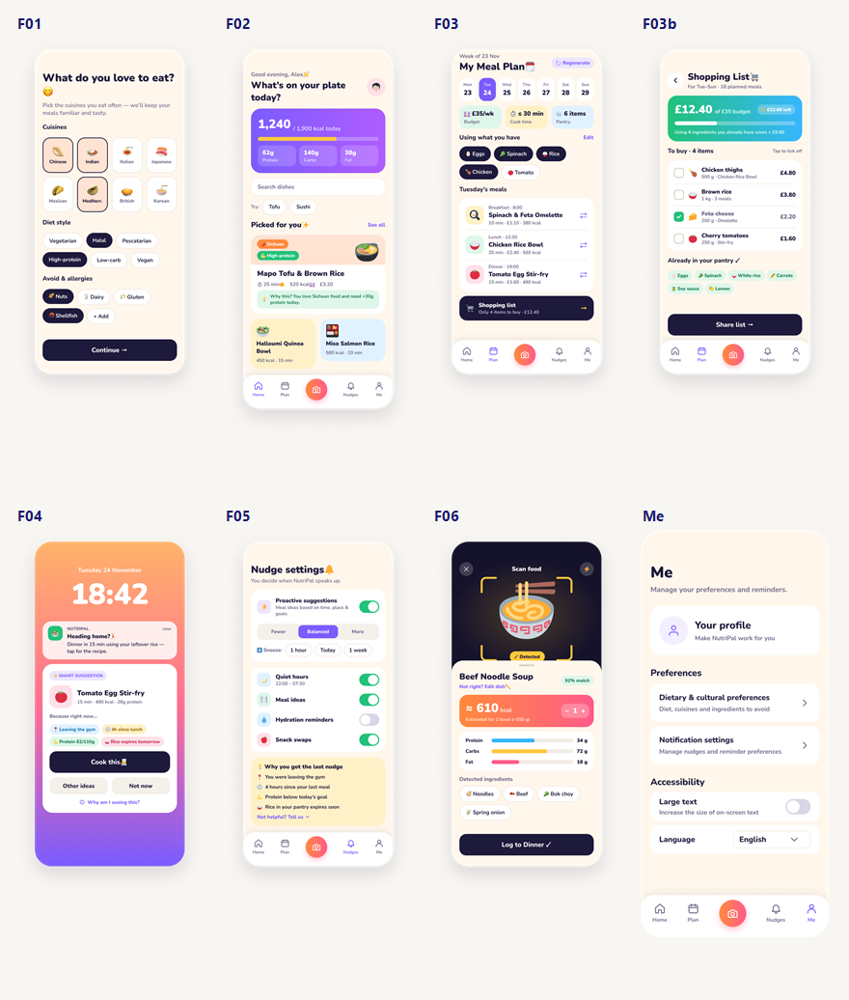

# NutriPal Figma Design Archive v3 (2026-11-25)

**Language: [中文](README.md) | English**

[Large-text overview](screens-gallery-large-text.png) · [F07 dish details and swaps overview](screens-gallery-recipe-swaps.png)

## Source

- Figma: [NutriPal – Healthy Eating App (Copy)](https://www.figma.com/design/QHOOV8NcB4Ev499ycoRtZq/?node-id=0-1)
- File key `QHOOV8NcB4Ev499ycoRtZq`, page `App Screens` (`0:1`).
- The archive keeps its 2026-11-25 folder name and includes design updates through November 26.
- Eight main screens have default and large-text frames. Both F02 frames are 390 × 936. The other main screens are 390 × 844.

## Version changes

- **2026-11-25** — Added a large-text option and the Me page.
- **2026-11-26** — Selecting a dish opens its details and shows available food swaps. F07 covers browsing, previewing and applying lower- and higher-calorie swaps, along with hint dismissal, no calorie goal, dietary preferences and no suitable swaps.
- **2026-11-26** — Added a language selector to Me. The Figma component includes English, Chinese, Spanish, French, German, Arabic and Japanese, with 28 variants across standard and large text and open and closed states. See frame [2150:1000](https://www.figma.com/design/QHOOV8NcB4Ev499ycoRtZq/?node-id=2150-1000).

## Files

| File | Purpose |
| --- | --- |
| `screens/` | Original screen, label and component exports |
| `screens-gallery.png` | Eight default-size main screens |
| `screens-gallery-large-text.png` | Eight large-text main screens |
| `screens-gallery-recipe-swaps.png` | Eleven archived F07 states |
| `components-gallery.png` | Figma components area |
| `frames.json` | Frame IDs, dimensions, variants and capture paths |
| `checksums.sha256` | SHA-256 hashes for images and the frame index |

## Screen index

| Figma default / large text | Screen | Default | Large text |
| --- | --- | --- | --- |
| [3:6](https://www.figma.com/design/QHOOV8NcB4Ev499ycoRtZq/?node-id=3-6) / [2025:723](https://www.figma.com/design/QHOOV8NcB4Ev499ycoRtZq/?node-id=2025-723) | F01 · Dietary & Cultural Preferences | [PNG](screens/F01%20%C2%B7%20Dietary%20%26%20Cultural%20Preferences.png) | [PNG](screens/F01%20%C2%B7%20Dietary%20%26%20Cultural%20Preferences%20%C2%B7%20Large%20text.png) |
| [3:87](https://www.figma.com/design/QHOOV8NcB4Ev499ycoRtZq/?node-id=3-87) / [2025:762](https://www.figma.com/design/QHOOV8NcB4Ev499ycoRtZq/?node-id=2025-762) | F02 · Personalised Meal Recommendations | [PNG](screens/F02%20%C2%B7%20Personalised%20Meal%20Recommendations.png) | [PNG](screens/F02%20%C2%B7%20Personalised%20Meal%20Recommendations%20%C2%B7%20Large%20text.png) |
| [4:62](https://www.figma.com/design/QHOOV8NcB4Ev499ycoRtZq/?node-id=4-62) / [2025:827](https://www.figma.com/design/QHOOV8NcB4Ev499ycoRtZq/?node-id=2025-827) | F03 · Practical Meal Planning | [PNG](screens/F03%20%C2%B7%20Practical%20Meal%20Planning.png) | [PNG](screens/F03%20%C2%B7%20Practical%20Meal%20Planning%20%C2%B7%20Large%20text.png) |
| [26:209](https://www.figma.com/design/QHOOV8NcB4Ev499ycoRtZq/?node-id=26-209) / [2025:1075](https://www.figma.com/design/QHOOV8NcB4Ev499ycoRtZq/?node-id=2025-1075) | F03b · Shopping List | [PNG](screens/F03b%20%C2%B7%20Shopping%20List.png) | [PNG](screens/F03b%20%C2%B7%20Shopping%20List%20%C2%B7%20Large%20text.png) |
| [4:193](https://www.figma.com/design/QHOOV8NcB4Ev499ycoRtZq/?node-id=4-193) / [2025:912](https://www.figma.com/design/QHOOV8NcB4Ev499ycoRtZq/?node-id=2025-912) | F04 · Context-Aware Proactive Assistance | [PNG](screens/F04%20%C2%B7%20Context-Aware%20Proactive%20Assistance.png) | [PNG](screens/F04%20%C2%B7%20Context-Aware%20Proactive%20Assistance%20%C2%B7%20Large%20text.png) |
| [5:112](https://www.figma.com/design/QHOOV8NcB4Ev499ycoRtZq/?node-id=5-112) / [2025:955](https://www.figma.com/design/QHOOV8NcB4Ev499ycoRtZq/?node-id=2025-955) | F05 · Notification Control & Explanation | [PNG](screens/F05%20%C2%B7%20Notification%20Control%20%26%20Explanation.png) | [PNG](screens/F05%20%C2%B7%20Notification%20Control%20%26%20Explanation%20%C2%B7%20Large%20text.png) |
| [5:226](https://www.figma.com/design/QHOOV8NcB4Ev499ycoRtZq/?node-id=5-226) / [2025:1017](https://www.figma.com/design/QHOOV8NcB4Ev499ycoRtZq/?node-id=2025-1017) | F06 · AI Food Recognition & Calorie Estimation | [PNG](screens/F06%20%C2%B7%20AI%20Food%20Recognition%20%26%20Calorie%20Estimation.png) | [PNG](screens/F06%20%C2%B7%20AI%20Food%20Recognition%20%26%20Calorie%20Estimation%20%C2%B7%20Large%20text.png) |
| [2014:269](https://www.figma.com/design/QHOOV8NcB4Ev499ycoRtZq/?node-id=2014-269) / [2021:310](https://www.figma.com/design/QHOOV8NcB4Ev499ycoRtZq/?node-id=2021-310) | Me · Profile & Settings | [PNG](screens/Me%20%C2%B7%20Profile%20%26%20Settings.png) | [PNG](screens/Me%20%C2%B7%20Large%20text.png) |

### F07 dish details and swaps

| Frame | State | Capture |
| --- | --- | --- |
| [2113:621](https://www.figma.com/design/QHOOV8NcB4Ev499ycoRtZq/?node-id=2113-621) | F07a · Lower calories · 520 | [PNG](screens/F07a%20%C2%B7%20Lower%20calories%20%C2%B7%20520.png) |
| [2113:622](https://www.figma.com/design/QHOOV8NcB4Ev499ycoRtZq/?node-id=2113-622) | F07b · Lower swaps · Browse | [PNG](screens/F07b%20%C2%B7%20Lower%20swaps%20%C2%B7%20Browse.png) |
| [2113:623](https://www.figma.com/design/QHOOV8NcB4Ev499ycoRtZq/?node-id=2113-623) | F07c · Lower swaps · Preview | [PNG](screens/F07c%20%C2%B7%20Lower%20swaps%20%C2%B7%20Preview.png) |
| [2113:624](https://www.figma.com/design/QHOOV8NcB4Ev499ycoRtZq/?node-id=2113-624) | F07d · Swap applied · 400 | [PNG](screens/F07d%20%C2%B7%20Swap%20applied%20%C2%B7%20400.png) |
| [2113:625](https://www.figma.com/design/QHOOV8NcB4Ev499ycoRtZq/?node-id=2113-625) | F07e · Higher calories · 520 | [PNG](screens/F07e%20%C2%B7%20Higher%20calories%20%C2%B7%20520.png) |
| [2113:626](https://www.figma.com/design/QHOOV8NcB4Ev499ycoRtZq/?node-id=2113-626) | F07f · Higher swaps · Browse | [PNG](screens/F07f%20%C2%B7%20Higher%20swaps%20%C2%B7%20Browse.png) |
| [2113:627](https://www.figma.com/design/QHOOV8NcB4Ev499ycoRtZq/?node-id=2113-627) | F07g · Higher swaps · Preview | [PNG](screens/F07g%20%C2%B7%20Higher%20swaps%20%C2%B7%20Preview.png) |
| [2113:628](https://www.figma.com/design/QHOOV8NcB4Ev499ycoRtZq/?node-id=2113-628) | F07h · Swap applied · 610 | [PNG](screens/F07h%20%C2%B7%20Swap%20applied%20%C2%B7%20610.png) |
| [2113:629](https://www.figma.com/design/QHOOV8NcB4Ev499ycoRtZq/?node-id=2113-629) | F07i · Hint dismissed · 520 | [PNG](screens/F07i%20%C2%B7%20Hint%20dismissed%20%C2%B7%20520.png) |
| [2113:630](https://www.figma.com/design/QHOOV8NcB4Ev499ycoRtZq/?node-id=2113-630) | F07j · No calorie goal · 520 | [PNG](screens/F07j%20%C2%B7%20No%20calorie%20goal%20%C2%B7%20520.png) |
| [2113:631](https://www.figma.com/design/QHOOV8NcB4Ev499ycoRtZq/?node-id=2113-631) | F07k · Dietary preferences · 520 | [PNG](screens/F07k%20%C2%B7%20Dietary%20preferences%20%C2%B7%20520.png) |
| [2113:632](https://www.figma.com/design/QHOOV8NcB4Ev499ycoRtZq/?node-id=2113-632) | F07l · No suitable swaps | — |

## Verification

| Check | Result |
| --- | --- |
| Main screen captures | All 16 present. Export dimensions are recorded in `frames.json` |
| F07 states | Twelve in Figma and eleven captures archived. F07l is available in Figma |
| Language selector | Frame and 28 component variants verified in Figma. A standalone capture is absent |
| File integrity | See `checksums.sha256` |
