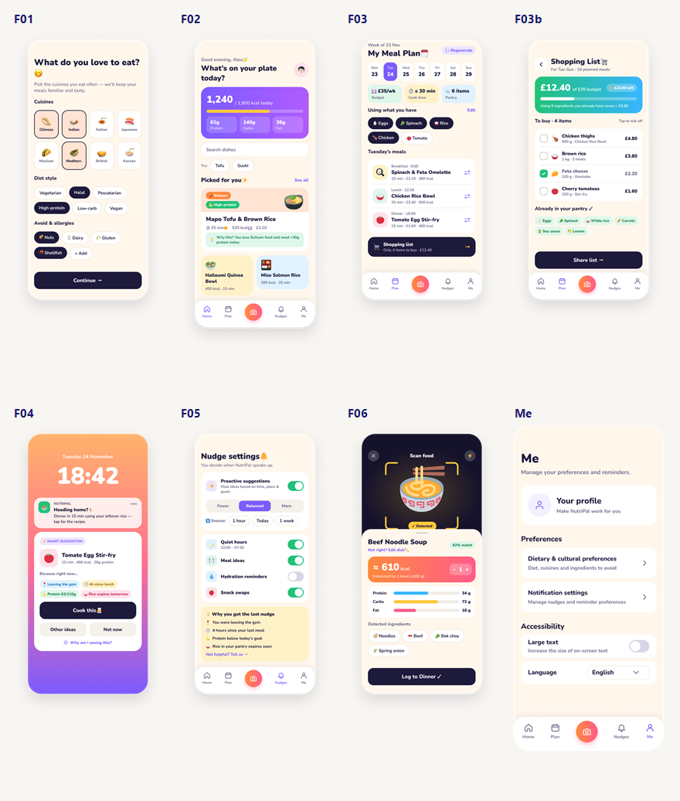

# NutriPal Figma 设计归档 v3（2026-11-25）

**语言：中文 | [English](README.en.md)**

[大字号总览](screens-gallery-large-text.png) · [F07 菜品详情与替换总览](screens-gallery-recipe-swaps.png)

## 来源

- Figma：[NutriPal – Healthy Eating App (Copy)](https://www.figma.com/design/QHOOV8NcB4Ev499ycoRtZq/?node-id=0-1)
- 文件键 `QHOOV8NcB4Ev499ycoRtZq`，页面 `App Screens`（`0:1`）
- 归档目录沿用 2026-11-25 的命名，涵盖截至 11 月 26 日的设计更新。
- 主界面共 8 个，每个都有默认和大字号画板。F02 为 390 × 936，其余为 390 × 844。

## 版本更新

- **2026-11-25**　新增大字号选项和「我的（Me）」页面。
- **2026-11-26**　点击菜品可打开详情并查看可替换的食物。F07 展示低热量和高热量替换项的浏览、预览及应用流程，也覆盖关闭提示、未设置目标、饮食偏好和无合适替换项。
- **2026-11-26**　「我的」页面新增语言选择。Figma 组件包含英语、中文、西班牙语、法语、德语、阿拉伯语和日语，共 28 个变体，覆盖默认和大字号以及展开和收起状态。画板 [2150:1000](https://www.figma.com/design/QHOOV8NcB4Ev499ycoRtZq/?node-id=2150-1000)。

## 文件

| 文件 | 用途 |
| --- | --- |
| `screens/` | 原始导出截图、标签和组件 |
| `screens-gallery.png` | 8 个默认字号主界面总览 |
| `screens-gallery-large-text.png` | 8 个大字号主界面总览 |
| `screens-gallery-recipe-swaps.png` | 已归档的 11 个 F07 状态总览 |
| `components-gallery.png` | Figma 组件区截图 |
| `frames.json` | 画板 ID、尺寸、变体及截图路径 |
| `checksums.sha256` | 截图和画板索引的 SHA-256 校验值 |

## 画板索引

| Figma 默认 / 大字号 | 界面 | 默认 | 大字号 |
| --- | --- | --- | --- |
| [3:6](https://www.figma.com/design/QHOOV8NcB4Ev499ycoRtZq/?node-id=3-6) / [2025:723](https://www.figma.com/design/QHOOV8NcB4Ev499ycoRtZq/?node-id=2025-723) | F01 饮食与文化偏好 | [PNG](screens/F01%20%C2%B7%20Dietary%20%26%20Cultural%20Preferences.png) | [PNG](screens/F01%20%C2%B7%20Dietary%20%26%20Cultural%20Preferences%20%C2%B7%20Large%20text.png) |
| [3:87](https://www.figma.com/design/QHOOV8NcB4Ev499ycoRtZq/?node-id=3-87) / [2025:762](https://www.figma.com/design/QHOOV8NcB4Ev499ycoRtZq/?node-id=2025-762) | F02 个性化餐食推荐 | [PNG](screens/F02%20%C2%B7%20Personalised%20Meal%20Recommendations.png) | [PNG](screens/F02%20%C2%B7%20Personalised%20Meal%20Recommendations%20%C2%B7%20Large%20text.png) |
| [4:62](https://www.figma.com/design/QHOOV8NcB4Ev499ycoRtZq/?node-id=4-62) / [2025:827](https://www.figma.com/design/QHOOV8NcB4Ev499ycoRtZq/?node-id=2025-827) | F03 实用膳食规划 | [PNG](screens/F03%20%C2%B7%20Practical%20Meal%20Planning.png) | [PNG](screens/F03%20%C2%B7%20Practical%20Meal%20Planning%20%C2%B7%20Large%20text.png) |
| [26:209](https://www.figma.com/design/QHOOV8NcB4Ev499ycoRtZq/?node-id=26-209) / [2025:1075](https://www.figma.com/design/QHOOV8NcB4Ev499ycoRtZq/?node-id=2025-1075) | F03b 购物清单 | [PNG](screens/F03b%20%C2%B7%20Shopping%20List.png) | [PNG](screens/F03b%20%C2%B7%20Shopping%20List%20%C2%B7%20Large%20text.png) |
| [4:193](https://www.figma.com/design/QHOOV8NcB4Ev499ycoRtZq/?node-id=4-193) / [2025:912](https://www.figma.com/design/QHOOV8NcB4Ev499ycoRtZq/?node-id=2025-912) | F04 情境感知主动辅助 | [PNG](screens/F04%20%C2%B7%20Context-Aware%20Proactive%20Assistance.png) | [PNG](screens/F04%20%C2%B7%20Context-Aware%20Proactive%20Assistance%20%C2%B7%20Large%20text.png) |
| [5:112](https://www.figma.com/design/QHOOV8NcB4Ev499ycoRtZq/?node-id=5-112) / [2025:955](https://www.figma.com/design/QHOOV8NcB4Ev499ycoRtZq/?node-id=2025-955) | F05 通知控制与解释 | [PNG](screens/F05%20%C2%B7%20Notification%20Control%20%26%20Explanation.png) | [PNG](screens/F05%20%C2%B7%20Notification%20Control%20%26%20Explanation%20%C2%B7%20Large%20text.png) |
| [5:226](https://www.figma.com/design/QHOOV8NcB4Ev499ycoRtZq/?node-id=5-226) / [2025:1017](https://www.figma.com/design/QHOOV8NcB4Ev499ycoRtZq/?node-id=2025-1017) | F06 AI 食物识别与热量估算 | [PNG](screens/F06%20%C2%B7%20AI%20Food%20Recognition%20%26%20Calorie%20Estimation.png) | [PNG](screens/F06%20%C2%B7%20AI%20Food%20Recognition%20%26%20Calorie%20Estimation%20%C2%B7%20Large%20text.png) |
| [2014:269](https://www.figma.com/design/QHOOV8NcB4Ev499ycoRtZq/?node-id=2014-269) / [2021:310](https://www.figma.com/design/QHOOV8NcB4Ev499ycoRtZq/?node-id=2021-310) | Me 我的 · 个人资料与设置 | [PNG](screens/Me%20%C2%B7%20Profile%20%26%20Settings.png) | [PNG](screens/Me%20%C2%B7%20Large%20text.png) |

### F07 菜品详情与替换

| 画板 | 状态 | 截图 |
| --- | --- | --- |
| [2113:621](https://www.figma.com/design/QHOOV8NcB4Ev499ycoRtZq/?node-id=2113-621) | F07a · 降低热量提示（520 kcal） | [PNG](screens/F07a%20%C2%B7%20Lower%20calories%20%C2%B7%20520.png) |
| [2113:622](https://www.figma.com/design/QHOOV8NcB4Ev499ycoRtZq/?node-id=2113-622) | F07b · 浏览低热量替换选项 | [PNG](screens/F07b%20%C2%B7%20Lower%20swaps%20%C2%B7%20Browse.png) |
| [2113:623](https://www.figma.com/design/QHOOV8NcB4Ev499ycoRtZq/?node-id=2113-623) | F07c · 预览低热量替换项 | [PNG](screens/F07c%20%C2%B7%20Lower%20swaps%20%C2%B7%20Preview.png) |
| [2113:624](https://www.figma.com/design/QHOOV8NcB4Ev499ycoRtZq/?node-id=2113-624) | F07d · 应用替换（400 kcal） | [PNG](screens/F07d%20%C2%B7%20Swap%20applied%20%C2%B7%20400.png) |
| [2113:625](https://www.figma.com/design/QHOOV8NcB4Ev499ycoRtZq/?node-id=2113-625) | F07e · 提高热量提示（520 kcal） | [PNG](screens/F07e%20%C2%B7%20Higher%20calories%20%C2%B7%20520.png) |
| [2113:626](https://www.figma.com/design/QHOOV8NcB4Ev499ycoRtZq/?node-id=2113-626) | F07f · 浏览高热量替换选项 | [PNG](screens/F07f%20%C2%B7%20Higher%20swaps%20%C2%B7%20Browse.png) |
| [2113:627](https://www.figma.com/design/QHOOV8NcB4Ev499ycoRtZq/?node-id=2113-627) | F07g · 预览高热量替换项 | [PNG](screens/F07g%20%C2%B7%20Higher%20swaps%20%C2%B7%20Preview.png) |
| [2113:628](https://www.figma.com/design/QHOOV8NcB4Ev499ycoRtZq/?node-id=2113-628) | F07h · 应用替换（610 kcal） | [PNG](screens/F07h%20%C2%B7%20Swap%20applied%20%C2%B7%20610.png) |
| [2113:629](https://www.figma.com/design/QHOOV8NcB4Ev499ycoRtZq/?node-id=2113-629) | F07i · 关闭提示（520 kcal） | [PNG](screens/F07i%20%C2%B7%20Hint%20dismissed%20%C2%B7%20520.png) |
| [2113:630](https://www.figma.com/design/QHOOV8NcB4Ev499ycoRtZq/?node-id=2113-630) | F07j · 未设置热量目标（520 kcal） | [PNG](screens/F07j%20%C2%B7%20No%20calorie%20goal%20%C2%B7%20520.png) |
| [2113:631](https://www.figma.com/design/QHOOV8NcB4Ev499ycoRtZq/?node-id=2113-631) | F07k · 饮食偏好（520 kcal） | [PNG](screens/F07k%20%C2%B7%20Dietary%20preferences%20%C2%B7%20520.png) |
| [2113:632](https://www.figma.com/design/QHOOV8NcB4Ev499ycoRtZq/?node-id=2113-632) | F07l · 没有合适的替换项 | — |

## 验证

| 检查项 | 结果 |
| --- | --- |
| 主界面截图 | 16 张齐全，导出尺寸已记录于 `frames.json` |
| F07 状态 | Figma 共 12 个，归档含 11 张截图。F07l 在 Figma 中可查看 |
| 语言选择器 | 已核对 Figma 中的画板和 28 个组件变体，归档缺少独立截图 |
| 文件校验 | 见 `checksums.sha256` |
