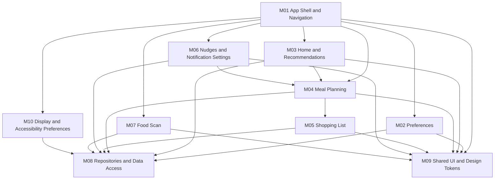

# NutriPal Module Design

**Language: [中文](module-design.md) | English**

> - Status: design baseline v1.1 (2026-11-26)
> - Parent design: [System design](system-design.en.md)
> - Scope: module boundaries, state, interfaces, and acceptance rules; no code implementation.

## 1. Module Map



### 1.1 Dependency rules

1. Page modules may depend only on their own state, the Repositories exposed by `M08`, and shared components from `M09`.
2. UI must not call HTTP directly, call third-party SDKs, read system-notification permissions, or access browser storage.
3. Shared components contain no business rules; domain rules belong to the owning module.
4. Modules do not share mutable objects. Cross-module data is reread through Repositories or read-only queries.
5. Only `M08` knows the differences between `MockNutriPalApi`, the future HTTP API, and Provider Adapters.
6. `M01` registers all routes; page modules must not silently create alternate routes.

## 2. Route and Navigation Contract

| Route | Frame | Module | Bottom navigation | Entry/exit behaviour |
| --- | --- | --- | --- | --- |
| `/preferences` | F01 | Preferences | Hidden | First launch or no preferences; Continue → `/home` |
| `/preferences?mode=edit` | F01 | Preferences | Hidden | Me entry; save/cancel returns to source |
| `/home` | F02 | Home & Recommendations | Home active | Preferences complete; recommendations home |
| `/plan` | F03 | Meal Planning | Plan active | Preferences complete; F04 `Cook this` opens the matching plan |
| `/plan/shopping-list` | F03b | Shopping List | Plan active | From F03 shopping-list entry; back → `/plan` |
| `/scan` | F06 | Food Scan | Scan active | Main navigation; close → `/home`; Add to log → `/home` |
| `/nudges/settings` | F05 | Nudges | Nudges active | Main navigation; can focus the explanation section |
| `/nudges/preview` | F04 | Nudges | Hidden | Notification-preview/simulation entry; does not require real system notifications |
| `/me` | Me | Display / Profile | Me active | Main navigation; profile, preference/nudge entries, language, large text, nudge preview and privacy |

- If onboarding is incomplete, all routes except `/preferences` redirect to `/preferences`.
- Unknown routes go to `/home`; if onboarding is incomplete, they go to `/preferences`.
- `/me` is an independent settings screen; its Dietary row opens `/preferences?mode=edit`.
- Bottom navigation contains Home, Plan, Scan, Nudges, and Me. F01 and F04 do not show it.

## 3. Module Design

### M01 App Shell and Navigation

**Responsibilities**

- Provide the app frame, bottom navigation, route registration, onboarding guard, global error boundary and offline/mock-data indication. By v1.1 decision, no simulated status bar or phone frame is shown.
- Maintain the current route and active navigation state; it owns no preference, meal-plan, nudge, or scan data.

**Inputs/outputs**

- Inputs: `Profile.onboardingCompleted`, current route, global error/offline state.
- Outputs: page container, navigation actions, redirects, global notices.

**State**

- `routeReady`, `activeTab`, `isOfflinePreview`, `fatalError`.
- Saved page data survives route changes; unsaved forms do not.

**Acceptance**

- F01/F04 do not show bottom navigation; F02/F03/F03b/F05/F06 show the correct active tab.
- Users without completed onboarding cannot directly enter `/home`, `/plan`, or other routes.
- Every page error has a recovery action and cannot cause a blank screen.

### M02 Preferences

**Screens:** F01, `/preferences`, `/preferences?mode=edit`.

**Responsibilities**

- Edit cuisines, diet styles, and allergens/avoidances and save `DietaryPreferences`.
- Set `onboardingCompleted=true` when the first-run flow is saved.
- Show saving, save failure, saved, and simulated-preference states.

**Interaction rules**

- Cuisines are multi-select; no user preference is preselected by default.
- Diet styles are multi-select. The redundant “No preference” chip is removed; an empty selection is the no-preference state.
- Allergens/avoidances are multi-select. An empty selection means “not specified”, not “no allergies”.
- A + Add action opens a local sheet for a custom ingredient/allergen. Values are de-duplicated and saved with Continue; no backend field is added.
- Edit mode shows a back control to Me; first-run onboarding does not show a back control for non-existent steps.
- Continue is never disabled just because nothing is selected; arrays may be empty.
- `mode=edit` distinguishes editing: saving returns to the source screen and cancelling returns there too. First-run onboarding can advance only by saving.
- A save failure preserves form values and offers retry; repeated clicks send only one request.

**Writes**

- Use only `ProfileRepository.updatePreferences()`. On success, mark recommendations stale.
- Do not update the meal plan or shopping list directly; they use new preferences only on the next generation.
- F01 displays `2 / 4`, but only this onboarding screen is archived. V1 does not invent the other three steps: treat this screen as the complete preference entry, keep the progress marker as a design gap, and set `onboardingCompleted=true` after a successful save.

**Acceptance**

- Saved preferences survive a page reload (Mock storage or future API).
- Allergen selection shows a protective notice that filtering cannot guarantee complete allergen exclusion.
- Saving/cancelling edit mode does not re-trigger onboarding.

### M03 Home and Recommendations

**Screens:** F02, `/home`.

**Responsibilities**

- Show today’s calorie and protein/carbohydrate/fat summary.
- Show 1–3 personalised recommendations with a “why recommended” explanation.
- Provide search through a Supabase-compatible mock with 91 recipes, covering English, Chinese, multi-word, closest-match and no-result suggestion states.
- Expand more recommendations on the same page; no new recipe-detail route.

**Interaction rules**

- Show a skeleton/loading state first, then calories and recommendations.
- `See all` requests `limit=10` and expands the result inline; pressing again collapses it.
- Recommendation cards are informational. Without a designed detail screen, do not add “add to plan” or a recipe-detail route.
- Nutrition summary is derived from FoodLogEntry values; with no entries, show `0 / target` and an empty-state prompt.
- If the provider fails, show cached content or an explicit “recommendations unavailable” state; never fabricate new recommendations.

**Reads**

- `GET /recommendations` returns `RecommendationBundle`; the module does not read RecipeProvider directly.
- Refetch after preferences are saved; do not merge local preferences manually.
- Search goes through RecipeRepository against the local recipes table and returns title, category, area, ingredients and source; it does not fabricate nutrition data.

**Acceptance**

- Explanations match the API’s `whyRecommended`/reason fields.
- Returning home after adding a FoodLogEntry immediately reflects the new summary.
- Empty and error states both offer a next action.

### M04 Meal Planning

**Screen:** F03, `/plan`.

**Responsibilities**

- Display/generate a weekly meal plan and handle date selection, meal swaps, budget, cooking time, and pantry constraints.
- Provide the shopping-list entry; do not own shopping-item purchased state.

**Interaction rules**

- Default to the current week’s Tuesday or the nearest date that has a plan; changing the date only changes the view, not generation.
- `Regenerate` asks for confirmation when a custom plan exists, then replaces the whole weekly `MealPlan`.
- A single-meal `⇄` replacement updates only the current `mealId`; failure restores the previous visual state.
- `Edit` opens a shared Bottom Sheet for `budget`, `maxCookMinutes`, and `pantryItems`; no new route.
- The shopping-list entry opens `/plan/shopping-list`.
- Every successful meal-plan update triggers shopping-list recalculation. Shopping-list failure does not prevent plan saving but must show an error.

**State**

- `weekStart`, `selectedDate`, `mealPlan`, `isGenerating`, `isSwapping`, `planError`, `constraintsDraft`.

**Acceptance**

- There is only one MealPlan per week; changing days never duplicates it.
- Generation failure preserves the old plan; replacement failure preserves the old meal.
- The shopping list reflects the latest plan while preserving purchased state when an item still exists.

### M05 Shopping List

**Screen:** F03b, `/plan/shopping-list`.

**Responsibilities**

- Show purchase items generated from MealPlan, budget, pantry items, and checked state.
- Write only `ShoppingListItem.purchased`; do not modify budget or meal plans.

**Interaction rules**

- Back returns to F03; Plan remains the active tab.
- Checking/unchecking is saved through PATCH; failure restores the previous value and shows a short error.
- Budget and remaining values are returned by the service/Mock. The UI only formats those values and does not independently recalculate them. Monetary values use two decimals.
- `Share list` is the primary action and uses Web Share or a copy notice. `Order for delivery (demo)` is a secondary action that creates no order and requests no payment.
- An empty list says “Plan this week’s meals first” and offers a return to `/plan`.

**Acceptance**

- After a meal-plan change, added/removed items and budget summary are consistent.
- Purchased state survives refresh. On recalculation, preserve checked state using normalised name + unit as the match key.
- No real ordering, payment, or external merchant request occurs.

### M06 Nudges and Notification Settings

**Screens:** F04 `/nudges/preview`, F05 `/nudges/settings`.

**Responsibilities**

- Select at most one Nudge consistent with category, frequency, quiet hours, and coarse context.
- Show title, body, trigger reasons, primary action, and secondary actions.
- Manage proactive-suggestion enablement, frequency, categories, quiet hours, and explanation of the latest nudge.

**F04 rules**

- Opened only from the `NotificationScheduler` preview/simulation entry; do not request system-notification permission automatically.
- `Cook this` → `/plan`; `Other ideas` cycles to the next available Mock Nudge; `Not now` records dismissed and closes the preview.
- `Why am I seeing this?` → `/nudges/settings#why-last`.
- A nudge is not shown during quiet hours by default; explicit preview may bypass the window but must be labelled “Preview”.

**F05 rules**

- Turning off the Proactive suggestions master switch pauses all categories. Re-enabling preserves category selection.
- Snooze options `1 hour`, `Today`, and `1 week` store an absolute expiry time, not vague display text.
- `Fewer / Balanced / More` changes pacing only, not category switches.
- Quiet hours default to 22:00–07:30 in device-local time; equal start/end times are invalid and must show an error.
- “Why you got the last nudge” uses the latest Nudge’s `reasonFactors`; show an empty state when there is no history.
- `Not helpful? Tell us →` opens a local feedback Bottom Sheet, records one anonymous reason, and closes; it sends nothing externally.

**Acceptance**

- Precedence is fixed: master switch > snooze/quiet hours > category > frequency.
- Any settings-write failure restores previous values and offers retry.
- Simulated notifications and real push use the same `Nudge` DTO and are never merchant/advertising notifications.

### M07 Food Scan

**Screen:** F06, `/scan`.

**Responsibilities**

- Start a simulated scan or reserve a real image-recognition path.
- Show detection result, confidence, portion, calories, macronutrients, and ingredients.
- Adjust 1–5 portions and recalculate values; add the result to the daily log after confirmation.

**Interaction rules**

- V1 “Scan” uses a Mock fixture and requests no camera permission; the button returns a result after a fixed delay.
- `− / +` changes only the draft portion; baseline values remain immutable, and displayed values = baseline × portions.
- When confidence is below 0.8 or the Mock sets `needsReview=true`, highlight “Please verify the dish”.
- `Edit dish` opens a local Bottom Sheet with fixed candidate dishes; no new page.
- `Log to Dinner` is enabled only after a successful recognition; success returns to `/home`.
- Closing the scan returns to `/home` and discards the temporary result.

**Data rules**

- Raw images or image references must not be persisted; `FoodScanResult` lives in memory.
- `POST /food-logs` uses the current portion-derived values; repeated clicks use the same `Idempotency-Key`.
- Estimates are not medical advice; the UI must display “Estimated values, for reference only”.

**Acceptance**

- Changing portions from 1 to 3 scales calories and all macros proportionally.
- Scan failure can be retried; empty results and low confidence can be corrected.
- Adding to the log updates the F02 summary, while the temporary scan is discarded.

### M08 Repositories and Data Access

**Responsibilities**

- Provide stable domain interfaces to page modules.
- Implement API DTO validation, domain mapping, error normalisation, timeouts, retries, and caching.
- Switch between Mock and future HTTP implementations without exposing vendor differences to UI.

**Repository interfaces**

```ts
interface ProfileRepository {
  getProfile(): Promise<Profile>;
  updatePreferences(input: DietaryPreferencesInput): Promise<DietaryPreferences>;
}

interface RecommendationRepository {
  getDailyRecommendations(date: ISODate, limit?: number): Promise<RecommendationBundle>;
}

interface MealPlanRepository {
  getWeek(weekStart: ISODate): Promise<MealPlan | null>;
  generateWeek(weekStart: ISODate, input: MealPlanInput): Promise<MealPlan>;
  swapMeal(weekStart: ISODate, mealId: ID): Promise<MealPlan>;
}

interface ShoppingListRepository {
  getWeek(weekStart: ISODate): Promise<ShoppingList>;
  setPurchased(weekStart: ISODate, itemId: ID, purchased: boolean): Promise<ShoppingListItem>;
}

interface RecipeRepository {
  search(query: string, limit?: number): Promise<RecipeSearchResponse>;
}

interface NudgeRepository {
  getNext(context: NudgeContext): Promise<Nudge | null>;
  getSettings(): Promise<NudgeSettings>;
  updateSettings(patch: NudgeSettingsPatch): Promise<NudgeSettings>;
}

interface FoodScanRepository {
  recognize(input: FoodScanInput): Promise<FoodScanResult>;
  addToLog(scanId: ID, portion: number): Promise<FoodLogEntry>;
}

interface DisplayPreferenceRepository {
  get(): DisplayPreferences;
  update(patch: Partial<DisplayPreferences>): DisplayPreferences;
}
```

**Storage rules**

- Mock storage saves only non-sensitive domain data under keys prefixed `nutripal.v1.*`.
- The recipe catalog is read-only bundled data (91 rows) and is not written to localStorage; a real Supabase swap keeps the recipes table fields unchanged.
- After reload, restore Profile, DietaryPreferences, HealthTargets, MealPlan, ShoppingList, NudgeSettings, and FoodLogEntry.
- Display preferences are stored under nutripal.v1.display as textSize: default | large; missing means default.
- Never save raw images, raw GPS, complete provider responses, passwords, or tokens.
- Ignore unknown DTO fields; a missing required field yields `VALIDATION_ERROR`.

**Acceptance**

- Replacing `MockNutriPalApi` with an HTTP implementation requires no page-module changes.
- The same error yields the same `code`, `retryable` value, and recovery options in the UI.
- Mock data is reproducible after refresh and can be explicitly cleared.

### M09 Shared UI and Design Tokens

**Responsibilities**

- Provide domain-free shared components: BottomNav, Chip, CuisineTile, Toggle, SegmentedControl, SettingsRow, PrimaryButton, ChecklistItem, Sheet, EmptyState, ErrorState and Toast.
- Maintain accessibility and visual consistency.

**Confirmed or approximate tokens**

| Token | Value/rule | Source confidence |
| --- | --- | --- |
| `ink` | `#1E1A3C` | Archived HTML states it comes from Figma |
| `muted` | `#6E6A8A` | Archived HTML states it comes from Figma |
| `white` | `#FFFFFF` | Archived HTML states it comes from Figma |
| `bg` | `#FFF7EC` | 2026-11-25 Figma |
| `surface` | `#FFFFFF` | 2026-11-25 Figma |
| `line` | `#EEE6DA` | 2026-11-25 Figma |
| `purple` | `#7B5CFF` | 2026-11-25 Figma |
| `orange` | `#FF8A3D` | 2026-11-25 Figma |
| `pink` | `#FF5C8A` | 2026-11-25 Figma |
| `green` | `#22C27A` | 2026-11-25 Figma |
| `yellow` | `#FFC83D` | 2026-11-25 Figma |
| `blue` | `#38B6FF` | 2026-11-25 Figma |
| Radii | 16–26px cards/panels; pill chips | From archived HTML; needs visual review |
| Touch | Minimum 44×44px | Accessibility baseline |

**Rules**

- Components do not read APIs or decide business navigation; pages inject props/events.
- Bottom navigation and F04/F05 toggles must have accessible names and keyboard operation.
- Under `prefers-reduced-motion`, remove unnecessary transitions.
- Colour contrast must meet WCAG AA; status also uses text or graphics, not colour alone.
- Icons use Lucide + FoodGlyph only; Figma emoji are not adopted.

### M10 Display and Accessibility Preferences

**Screen**: the Accessibility block in Me.

**Responsibilities**

- Persist and apply global text size.
- Set data-text-size on the root element to drive semantic type tokens.
- Read no third-party data and change neither dietary preferences nor nudge settings.

**Interaction rules**

- Default is default; enabling Large text selects large.
- Write nutripal.v1.display and apply immediately to every page and sheet.
- Allow vertical scrolling when type grows; never clip or hide key controls.

**Acceptance**

- Large text survives refresh.
- All eight routes work in both sizes.
- Turning large text off restores default tokens.

## 4. Cross-module State and Invalidation Rules

| Action | Writer | Must invalidate/refresh | Must not happen |
| --- | --- | --- | --- |
| Save preferences | ProfileRepository | Recommendations | Do not automatically overwrite an existing meal plan |
| Generate/replace meal plan | MealPlanRepository | ShoppingList | Do not directly modify shopping-item checks |
| Check shopping item | ShoppingListRepository | F03b summary | Do not write back to MealPlan |
| Change Nudge settings | NudgeRepository | Next Nudge query, F04 preview | Do not schedule advertising/marketing notifications |
| Add food log | FoodScanRepository | Home nutrition summary | Do not retain the raw scan |

Do not use a large global event bus for these links; application code explicitly refreshes the corresponding query after a Repository call.

## 5. Errors, Empty States, and Recovery

| Scenario | UI behaviour |
| --- | --- |
| `VALIDATION_ERROR` | Mark fields in place, preserve input, do not submit partial data |
| `NOT_FOUND` | Show empty state with a create/return action |
| `PROVIDER_UNAVAILABLE` | Show unavailable/cached notice; allow retry; never fabricate live results |
| `RATE_LIMITED` | Show a later-retry message and do not loop requests |
| `CONFLICT` | Explain that data has changed and reload |
| Network timeout | Automatically retry ordinary GET once; otherwise offer retry |
| Unknown error | Show a generic recovery message and log a non-sensitive requestId |

All modules use `loading / success / empty / error`; pages may add derived states such as `saving`, `swapping`, and `scanning`.

## 6. Explicit Figma Gaps

| Gap | V1 decision |
| --- | --- |
| F01 shows `2 / 4`, but other onboarding steps are missing | V1 implements only the archived preference screen; saving completes onboarding without inventing steps 1/3/4 |
| Me screen | Implemented as an independent settings screen; the Dietary row reuses F01 edit mode |
| F01 `+ Add` has no expanded design | Local sheet adds a custom ingredient/allergen and saves it with preferences |
| F02 search has no empty-state design | Filter in place; empty results offer clear search |
| Figma uses emoji icons | Treated as a design-source defect; map to Lucide + FoodGlyph |
| Figma status bar/phone frame | Not implemented; keep the web content column |
| F02 `See all` has no destination | Expand more recommendations inline |
| F03 `Edit` has no destination | Shared Bottom Sheet for budget/time/pantry |
| F05 feedback link has no destination | Local feedback Bottom Sheet; send no external data |
| F06 `Edit dish` has no destination | Local candidate-dish Bottom Sheet |
| F03b `Order for delivery` has no flow | Secondary demo action after Share; no ordering or payment |
| F04 has no real background trigger | Preview/simulation only; Provider interface reserved |
| No recipe-detail screen | V1 creates no detail page; recommendation cards show only summary and reason |
| Real notification/camera permissions are not designed | V1 requests no permissions; real capability needs a separate privacy and failure flow |

These decisions keep the first version bounded and avoid hiding missing interaction design behind temporary pages.

## 7. Testing and Acceptance

### 7.1 Current documentation acceptance

- All eight screens (16 default/large-text frames) have a route, module, data source and acceptance entry.
- Routes and navigation state are consistent between system and module designs.
- All DTOs use the same names in the API contract, Repository, and module state.
- Mermaid diagrams render; Markdown links are valid; Mock capabilities are not described as live.
- Every hidden or missing Figma action has an explicit v1 decision.

### 7.2 Future implementation scenarios

1. First launch opens F01; saving preferences opens F02, and preferences survive refresh.
2. F02 recommendation failure shows an error and can recover on retry.
3. Generating the F03 weekly plan makes matching items and budget appear in F03b.
4. Replacing one F03 meal updates only affected F03b items.
5. Checked F03b items survive refresh.
6. Turning off proactive suggestions in F05 prevents non-preview F04 nudges.
7. When quiet hours cover the current time, the mock scheduler returns no Nudge.
8. F04 `Not now` prevents immediate repetition; `Cook this` focuses the corresponding meal.
9. F06 portion 1→3 scales calories/macros proportionally; adding the log updates F02.
10. Mock timeout, empty data, and provider-unavailable states are recoverable and never show fabricated data.
11. F02 Tofu/Sushi search, empty results and clear search all work.
12. Me large text persists, and all eight routes work in both sizes.

### 7.3 Module definition of done

- Pages access data only through Repositories.
- Every interaction has the applicable loading/error/empty state.
- Design gaps are not implemented as undocumented hidden pages.
- Key controls are keyboard and screen-reader accessible.
- No real sensitive data leaves the local environment.
