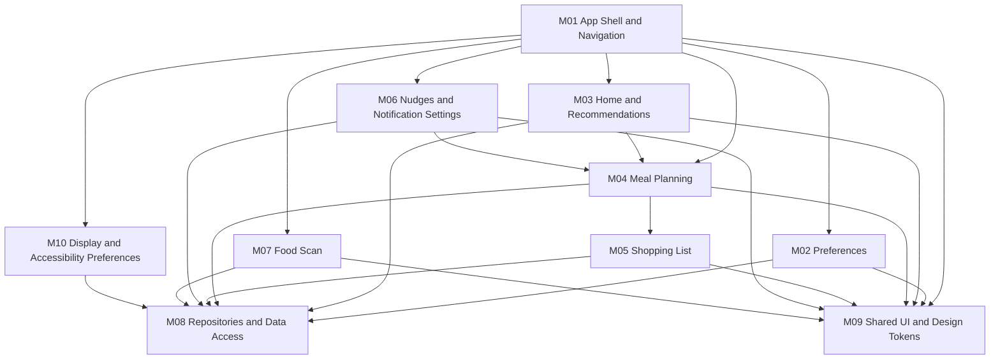

# NutriPal 模块设计

**语言：[中文](module-design.md) | [English](module-design.en.md)**

> - 状态：设计基线 v1.1（2026-11-26）
> - 上位设计：[系统设计](system-design.md)
> - 实现范围：模块边界、状态、接口和验收规则；不包含代码实现。

## 1. 模块地图



### 1.1 依赖规则

1. 页面模块只能依赖自己拥有的状态、`M08` 暴露的 Repository 和 `M09` 的共享组件。
2. UI 不直接请求 HTTP、调用第三方 SDK、读取系统通知权限或访问浏览器存储。
3. 共享组件不包含业务规则；领域规则放在所属模块。
4. 模块不共享可变对象。跨模块数据通过 Repository 重新读取或只读查询获取。
5. 只有 `M08` 知道 `MockNutriPalApi`、未来 HTTP API 和 Provider Adapter 的差异。
6. 所有路由由 `M01` 注册，页面模块不得静默创建旁路路由。

## 2. 路由与导航契约

| 路由 | Frame | 模块 | 底部导航 | 进入条件/跳转 |
| --- | --- | --- | --- | --- |
| `/preferences` | F01 | Preferences | 隐藏 | 首次启动或无偏好；Continue → `/home` |
| `/preferences?mode=edit` | F01 | Preferences | 隐藏 | Me 入口；保存/取消 → 来源页 |
| `/home` | F02 | Home & Recommendations | Home 激活 | 已完成偏好；推荐主入口 |
| `/plan` | F03 | Meal Planning | Plan 激活 | 已完成偏好；从 F04 `Cook this` 进入对应餐单 |
| `/plan/shopping-list` | F03b | Shopping List | Plan 激活 | 从 F03 的购物清单入口进入；返回 `/plan` |
| `/scan` | F06 | Food Scan | Scan 激活 | 主导航；关闭 → `/home`；加入日志 → `/home` |
| `/nudges/settings` | F05 | Nudges | Nudges 激活 | 主导航；解释最近提醒的锚点 |
| `/nudges/preview` | F04 | Nudges | 隐藏 | 仅通知预览/模拟入口；不依赖真实系统通知 |
| `/me` | Me | Display / Profile | Me 激活 | 主导航；个人资料、偏好/通知入口、语言、大字号、预览提醒和隐私说明 |

- 未完成引导时，除 `/preferences` 外的路由重定向到 `/preferences`。
- 未知路由回到 `/home`；若未完成引导则去 `/preferences`。
- `/me` 是独立设置页；Dietary & cultural preferences 行进入 `/preferences?mode=edit`。
- 底部导航只展示 Home、Plan、Scan、Nudges、Me；F01 和 F04 不展示底部导航。

## 3. 模块设计

### M01 App Shell and Navigation

**职责**

- 提供应用框架、底部导航、路由注册、onboarding guard、全局错误边界和离线/模拟数据提示；按 v1.1 决策不显示模拟状态栏或手机框。
- 维护当前路由和导航激活态；不拥有偏好、餐单、提醒或扫描数据。

**输入/输出**

- 输入：`Profile.onboardingCompleted`、当前路由、全局错误/离线状态。
- 输出：页面容器、导航动作、重定向、全局通知。

**状态**

- `routeReady`、`activeTab`、`isOfflinePreview`、`fatalError`。
- 页面切换时保留各页面自己的已保存数据，不保留未提交表单。

**验收**

- F01/F04 不显示底部导航；F02/F03/F03b/F05/F06 的激活 Tab 正确。
- 未完成引导无法直接进入 `/home`、`/plan` 等其他路由。
- 任何页面异常都有可返回的恢复操作，不能白屏。

### M02 Preferences

**页面**：F01、`/preferences`、`/preferences?mode=edit`。

**职责**

- 编辑菜系、饮食风格、过敏/忌口，保存 `DietaryPreferences`。
- 首次引导结束时设置 `onboardingCompleted=true`。
- 显示保存中、保存失败、已保存和模拟偏好提示。

**交互规则**

- 菜系多选；默认不预设用户偏好。
- 饮食风格多选；“No preference”与其他选项互斥，选择其他项时自动取消它。
- 过敏/忌口多选；未选择表示未填写，不表示“没有过敏”。
- 固定忌口之外提供 + Add，通过本地 Sheet 添加任意食材/过敏原；去重后随 Continue 保存，不新增后端字段。
- 编辑模式显示返回按钮并回到 /me；首次引导不显示返回，避免伪造不存在的 onboarding 步骤。
- Continue 不因未选择而禁用；允许先跳过，所有数组可为空。
- 编辑模式由 `mode=edit` 区分：保存后返回来源页，取消则返回来源页；首次引导只能通过保存前进。
- 保存失败保留表单值并显示重试；重复点击只发一个请求。

**数据写入**

- 仅通过 `ProfileRepository.updatePreferences()`；成功后将推荐标记为失效。
- 不直接修改餐单或购物清单；后续生成才使用新偏好。
- F01 显示 `2 / 4`，但归档中只有这一张 onboarding 页面。v1 不虚构其余 3 步：将该页视为完整偏好设置入口，进度标记作为设计缺口保留；`onboardingCompleted` 在本页保存成功后置为 `true`。

**验收**

- 刷新页面后已保存偏好仍在（Mock 存储或未来 API）。
- 过敏选择显示保护性提示：筛选不能保证完全排除过敏原。
- 编辑模式保存/取消都不会重复触发 onboarding。

### M03 Home and Recommendations

**页面**：F02、`/home`。

**职责**

- 展示当天热量与蛋白质/碳水/脂肪摘要。
- 展示 1–3 个个性化推荐及“为什么推荐”的解释。
- 提供基于 Supabase 兼容 Mock 的菜品搜索（91 道菜谱）；支持中英文、多词、相似结果和无结果建议。
- 在页面内展开更多推荐；不新增食谱详情路由。

**交互规则**

- 首次加载显示骨架/加载态；完成后显示卡路里和推荐列表。
- `See all` 以 `limit=10` 重新请求；成功后在同一页面展开，再次点击收起。
- 推荐卡片是信息展示；不在缺少设计稿时创建“加入餐单”或详情页。
- 营养摘要来自 FoodLogEntry 汇总；无记录时显示 `0 / target` 和空状态引导。
- Provider 失败时显示已缓存内容或明确的“推荐暂不可用”，不伪造新推荐。

**数据读取**

- `GET /recommendations` 返回 `RecommendationBundle`；不直接读取 RecipeProvider。
- 偏好保存后重新请求；不自行合并本地偏好。
- 搜索通过 RecipeRepository 查询本地 recipes 表；返回菜名、分类、地区、食材与来源，不伪造营养数据。

**验收**

- 推荐解释中的理由与接口 `whyRecommended`/原因字段一致。
- 切换回首页时，如果加入过 FoodLogEntry，摘要立即反映。
- 空数据和错误状态都提供下一步动作。

### M04 Meal Planning

**页面**：F03、`/plan`。

**职责**

- 展示/生成一周餐单，处理日期切换、替换单餐、预算、烹饪时间和已有食材约束。
- 提供购物清单入口；不拥有购物项勾选状态。

**交互规则**

- 默认显示本周周二或最近有餐单的日期；日期选择只切换当前查看内容，不自动生成。
- `Regenerate` 在已有自定义餐单时先确认替换；成功后更新本周整份 `MealPlan`。
- 单餐 `⇄` 只替换当前 `mealId`，保留其他日期和餐次；失败回滚视觉状态。
- `Edit` 打开共享 Bottom Sheet，编辑 `budget`、`maxCookMinutes` 和 `pantryItems`；不新增路由。
- 点击购物清单入口进入 `/plan/shopping-list`。
- 所有餐单更新成功后触发购物清单重算；购物清单失败不阻止餐单保存，但显示错误提示。

**状态**

- `weekStart`、`selectedDate`、`mealPlan`、`isGenerating`、`isSwapping`、`planError`、`constraintsDraft`。

**验收**

- 同一周只有一份 MealPlan；日期切换不会复制计划。
- 生成失败保留旧餐单；替换失败保留旧餐次。
- 购物清单反映最新餐单，并保留已勾选状态（如果采购项仍存在）。

### M05 Shopping List

**页面**：F03b、`/plan/shopping-list`。

**职责**

- 展示由 MealPlan 生成的采购项、预算、已有食材和勾选状态。
- 只写入 `ShoppingListItem.purchased`，不直接改预算或餐单。

**交互规则**

- 返回 F03；Plan Tab 保持激活。
- 勾选/取消勾选通过 PATCH 保存；请求失败则恢复旧值并显示短暂错误提示。
- 预算与剩余金额由服务端/Mock 返回，UI 不做独立计算以外的舍入决策；所有金额保留两位小数。
- `Share list` 是主操作，使用 Web Share 或复制提示；`Order for delivery (demo)` 作为次级按钮显示演示提示，不创建订单、不请求支付。
- 空清单显示“先规划本周餐单”，提供返回 `/plan`。

**验收**

- 餐单更改后新增/删除采购项与预算摘要一致。
- 刷新后已购买状态保留；重新计算购物清单时，以“规范化名称 + 单位”作为保留勾选状态的匹配键。
- 不存在真实下单、支付或外部商家请求。

### M06 Nudges and Notification Settings

**页面**：F04 `/nudges/preview`、F05 `/nudges/settings`。

**职责**

- 选择至多一条符合类别、频率、免打扰和粗粒度情境的 Nudge。
- 展示提醒标题、正文、触发原因、主要动作和次动作。
- 管理主动建议开关、频率、类别、免打扰和最近一次提醒的解释。

**F04 规则**

- 仅由 `NotificationScheduler` 的预览或模拟入口打开；不自动申请系统通知权限。
- `Cook this` → `/plan`；`Other ideas` 循环到下一个可用 Mock Nudge；`Not now` 记录 dismissed 并关闭预览。
- `Why am I seeing this?` → `/nudges/settings#why-last`。
- 默认不展示在免打扰时段；显式预览模式可绕过时段限制，但必须标注“预览”。

**F05 规则**

- Proactive suggestions 总开关关闭时，暂停全部类别；重新开启后保留类别选择。
- Snooze 选择 `1 hour`、`Today`、`1 week`；保存绝对到期时间，不使用模糊文案做数据。
- 频率 `Fewer / Balanced / More` 只改变建议节奏，不改变类别开关。
- Quiet hours 默认 22:00–07:30，使用设备本地时间；开始等于结束时视为无效并提示。
- “Why you got the last nudge” 来自最近 Nudge 的 `reasonFactors`；无历史时显示空状态。
- `Not helpful? Tell us →` 打开本地反馈 Bottom Sheet，记录一个匿名原因并关闭；不发送到外部服务。

**验收**

- 总开关、类别、频次、Snooze 和免打扰之间的优先级固定为：总开关 > Snooze/免打扰 > 类别 > 频次。
- 任何设置修改失败时恢复原值，并给出重试。
- 模拟通知与真实推送使用同一 `Nudge` DTO，不使用商户/广告通知。

### M07 Food Scan

**页面**：F06、`/scan`。

**职责**

- 启动模拟扫描或预留真实图片识别。
- 展示检测结果、置信度、份量、热量、宏量营养素和食材。
- 调整 1–5 份并同步重算数值；确认后写入当天日志。

**交互规则**

- 首版“扫描”使用 Mock fixture，不请求相机权限；按钮触发固定延迟后返回结果。
- `− / +` 只修改当前草稿的份量；原始基准值保持不可变，显示值 = 基准值 × 份量。
- 置信度低于 0.8 或 Mock 标记 `needsReview=true` 时，突出“请核对菜品”。
- `Edit dish` 打开本地 Bottom Sheet，从固定候选菜品中选择；不新增页面。
- `Log to Dinner` 只有在识别成功后可用；成功后返回 `/home`。
- 关闭扫描回到 `/home`，不保存临时结果。

**数据规则**

- 原图或图片引用不得写入持久层；`FoodScanResult` 保存于内存。
- `POST /food-logs` 使用当前份量计算结果；重复点击用同一个 `Idempotency-Key`。
- 估算值不等于医疗建议；界面必须显示“估算值，仅供参考”。

**验收**

- 份量从 1 调到 3 时，热量和营养素均按同一比例更新。
- 扫描失败可重试；空结果和低置信度可修正。
- 加入日志后 F02 摘要更新，临时 scan 不保留。

### M08 Repositories and Data Access

**职责**

- 对页面模块提供稳定的领域接口。
- 实现 API DTO 校验、领域映射、错误标准化、超时、重试和缓存策略。
- 在 Mock 与未来 HTTP 实现之间切换，不让 UI 感知供应商差异。

**Repository 接口**

```ts
interface ProfileRepository {
  getProfile(): Promise<Profile>;
  updatePreferences(input: DietaryPreferencesInput): Promise<DietaryPreferences>;
}

interface RecommendationRepository {
  getDailyRecommendations(date: ISODate, limit?: number): Promise<RecommendationBundle>;
}

interface MealPlanRepository {
  getWeek(weekStart: ISODate): Promise<MealPlan | null>;
  generateWeek(weekStart: ISODate, input: MealPlanInput): Promise<MealPlan>;
  swapMeal(weekStart: ISODate, mealId: ID): Promise<MealPlan>;
}

interface ShoppingListRepository {
  getWeek(weekStart: ISODate): Promise<ShoppingList>;
  setPurchased(weekStart: ISODate, itemId: ID, purchased: boolean): Promise<ShoppingListItem>;
}

interface RecipeRepository {
  search(query: string, limit?: number): Promise<RecipeSearchResponse>;
}

interface NudgeRepository {
  getNext(context: NudgeContext): Promise<Nudge | null>;
  getSettings(): Promise<NudgeSettings>;
  updateSettings(patch: NudgeSettingsPatch): Promise<NudgeSettings>;
}

interface FoodScanRepository {
  recognize(input: FoodScanInput): Promise<FoodScanResult>;
  addToLog(scanId: ID, portion: number): Promise<FoodLogEntry>;
}

interface DisplayPreferenceRepository {
  get(): DisplayPreferences;
  update(patch: Partial<DisplayPreferences>): DisplayPreferences;
}
```

**存储规则**

- Mock 存储只保存非敏感领域数据，键名统一为 `nutripal.v1.*`。
- 菜谱目录是只读 bundle 数据（91 条），不写入 localStorage；替换真实 Supabase 时保持 recipes 表字段不变。
- 页面刷新后可恢复：Profile、DietaryPreferences、HealthTargets、MealPlan、ShoppingList、NudgeSettings、FoodLogEntry。
- 显示偏好保存为 nutripal.v1.display，记录 textSize: default | large；缺失时默认 default。
- 不保存：原子图像、原始 GPS、完整 Provider 响应、密码/令牌。
- 未知 DTO 字段忽略；缺必填字段视为 `VALIDATION_ERROR`。

**验收**

- 替换 `MockNutriPalApi` 为 HTTP 实现时，页面模块无需改动。
- 同一错误在 UI 中得到相同的 `code`、`retryable` 和恢复选项。
- Mock 刷新后数据可复现；可显式清除本地演示数据。

### M09 Shared UI and Design Tokens

**职责**

- 提供无领域逻辑的共享组件：BottomNav、Chip、CuisineTile、Toggle、SegmentedControl、SettingsRow、PrimaryButton、ChecklistItem、Sheet、EmptyState、ErrorState 和 Toast。
- 维护可访问性和视觉一致性。

**已确认或近似的 tokens**

| Token | 值/规则 | 来源置信度 |
| --- | --- | --- |
| `ink` | `#1E1A3C` | 归档 HTML 声明来自 Figma |
| `muted` | `#6E6A8A` | 归档 HTML 声明来自 Figma |
| `white` | `#FFFFFF` | 归档 HTML 声明来自 Figma |
| `bg` | `#FFF7EC` | 2026-11-25 Figma |
| `surface` | `#FFFFFF` | 2026-11-25 Figma |
| `line` | `#EEE6DA` | 2026-11-25 Figma |
| `purple` | `#7B5CFF` | 2026-11-25 Figma |
| `orange` | `#FF8A3D` | 2026-11-25 Figma |
| `pink` | `#FF5C8A` | 2026-11-25 Figma |
| `green` | `#22C27A` | 2026-11-25 Figma |
| `yellow` | `#FFC83D` | 2026-11-25 Figma |
| `blue` | `#38B6FF` | 2026-11-25 Figma |
| 圆角 | 卡片/面板圆角 16–26px，芯片为 pill | 来自归档 HTML，需视觉评审 |
| 触控 | 最小 44×44px | 可及性基线 |

**规则**

- 组件不读取 API、不决定业务跳转；业务页面通过 props/事件注入。
- 底部导航和 F04/F05 的开关必须提供可访问名称和键盘操作。
- `prefers-reduced-motion` 下取消非必要过渡。
- 颜色对比达到 WCAG AA；状态同时使用文本/图形，不只靠颜色。
- 图标统一使用 Lucide + FoodGlyph；不采用 Figma 中的 emoji。

### M10 Display and Accessibility Preferences

**页面**：Me 的 Accessibility 区块。

**职责**

- 保存并应用全局字号偏好。
- 在根元素设置 data-text-size，驱动语义字号 token。
- 不读取第三方数据，不改变饮食偏好或提醒设置。

**交互规则**

- 默认字号为 default；开启 Large text 后为 large。
- 设置写入 nutripal.v1.display 并立即作用于所有页面和 Sheet。
- 字号增大后允许纵向滚动，不裁切或隐藏关键控件。

**验收**

- 刷新后保持大字号。
- 所有 8 个路由在两种字号下均可访问。
- 关闭大字号恢复默认 token。

## 4. 跨模块状态与失效规则

| 动作 | 写入 | 必须失效/刷新 | 不得发生 |
| --- | --- | --- | --- |
| 保存偏好 | ProfileRepository | Recommendations | 不自动覆盖已生成餐单 |
| 生成/替换餐单 | MealPlanRepository | ShoppingList | 不直接修改购物项勾选 |
| 勾选采购项 | ShoppingListRepository | F03b 摘要 | 不反写 MealPlan |
| 修改 Nudge 设置 | NudgeRepository | 下一次 Nudge 查询、F04 预览 | 不直接安排广告/营销通知 |
| 加入食物日志 | FoodScanRepository | Home 营养摘要 | 不保留原始扫描图 |

实现层不得使用大型全局事件总线串联这些动作；由应用层调用 Repository 后显式刷新对应查询。

## 5. 错误、空状态和恢复

| 场景 | UI 行为 |
| --- | --- |
| `VALIDATION_ERROR` | 就地标出字段，保留输入，不提交部分数据 |
| `NOT_FOUND` | 显示空状态和创建/返回动作 |
| `PROVIDER_UNAVAILABLE` | 显示不可用/缓存提示；允许重试；不伪造实时结果 |
| `RATE_LIMITED` | 显示稍后重试，不自动循环请求 |
| `CONFLICT` | 提示数据已更新，重新加载 |
| 网络超时 | 普通 GET 自动重试一次；超时后显示重试 |
| 未知错误 | 显示通用恢复提示，并记录不敏感 requestId |

所有模块统一使用 `loading / success / empty / error` 四态；具体页面可以增加 `saving`、`swapping`、`scanning` 等派生状态。

## 6. 已明确的 Figma 缺口

| 缺口 | 首版决定 |
| --- | --- |
| F01 显示 `2 / 4`，其余 onboarding 步骤缺失 | v1 只实现归档的偏好页；保存即完成 onboarding，不虚构第 1/3/4 步 |
| Me 页面 | 已作为独立设置页实现；Dietary 行复用 F01 编辑模式 |
| F01 `+ Add` 无展开稿 | 本地 Sheet 添加自定义食材/过敏原，随偏好保存 |
| F02 搜索无结果态设计 | 同页过滤，空结果提供清除搜索 |
| Figma 使用 emoji 图标 | 视为设计源失误，映射为 Lucide + FoodGlyph |
| Figma 状态栏/手机框 | 不实现，保持 Web 内容列 |
| F02 `See all` 无目标页 | 同页展开更多推荐 |
| F03 `Edit` 无目标页 | 共享 Bottom Sheet 编辑预算/时间/储藏物 |
| F05 反馈入口无目标页 | 本地反馈 Bottom Sheet，不发送外部数据 |
| F06 `Edit dish` 无目标页 | 本地候选菜品 Bottom Sheet |
| F03b `Order for delivery` 无流程 | 作为 Share 之后的次级演示按钮，不创建订单/支付 |
| F04 真实后台触发无来源 | 只做预览与模拟；Provider 接口预留 |
| 食谱详情无页面 | 首版不创建详情页，推荐卡只显示摘要与理由 |
| 真实通知/相机权限未设计 | 首版不请求权限；真实能力需单独设计隐私与失败流程 |

这些决定保持首版范围可控，并避免用“临时页面”掩盖缺失的交互设计。

## 7. 测试与验收

### 7.1 当前文档验收

- 8 个页面（默认/大字号共 16 个 Frame）均有路由、模块、数据来源和验收条目。
- 所有路由与导航状态在系统设计和模块设计中一致。
- 所有 DTO 在 API 契约、Repository 和模块状态中使用相同名称。
- Mermaid 图可渲染；Markdown 链接有效；没有将 Mock 能力写成真实已实现。
- 所有被 Figma 隐藏或缺少页面的动作都有明确首版决定。

### 7.2 后续实现测试场景

1. 首次进入 F01，保存偏好后进入 F02，刷新仍保留偏好。
2. F02 推荐失败时显示错误；恢复后可重新加载。
3. F03 生成周计划后，F03b 出现对应采购项和预算。
4. F03 替换一餐后，F03b 仅更新受影响条目。
5. F03b 勾选采购项后刷新仍保留状态。
6. F05 关闭主动建议后，F04 不再生成非预览 Nudge。
7. F05 免打扰时段覆盖当前时间时，模拟调度器不返回 Nudge。
8. F04 `Not now` 后当前 Nudge 不再重复出现；`Cook this` 定位到对应餐单。
9. F06 份量 1→3，热量和三大营养素按比例变化；加入日志后 F02 摘要更新。
10. Mock 超时、空数据、Provider 不可用时，页面均可恢复且不展示虚假数据。
11. F02 搜索 Tofu/Sushi、无结果和清除搜索均可用。
12. Me 大字号开关持久化，8 个路由在两种字号下均可访问。

### 7.3 模块完成标准

- 页面只通过 Repository 访问数据。
- 每个交互有 loading/error/empty 中至少适用的状态。
- 设计缺口没有被实现成未记录的隐藏页面。
- 关键按钮具备键盘和屏幕阅读器可用性。
- 没有真实敏感数据离开本地环境。
