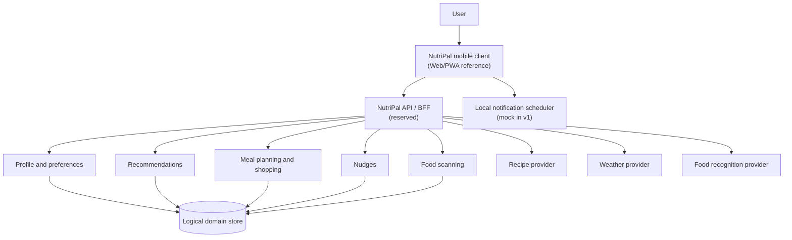
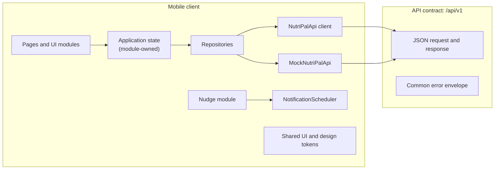
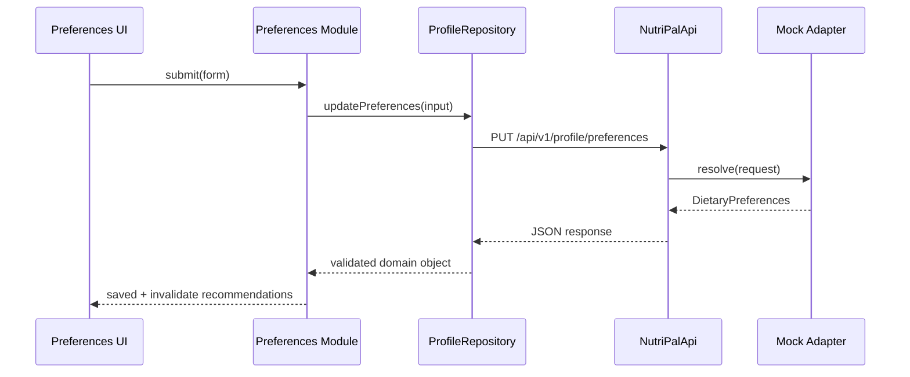
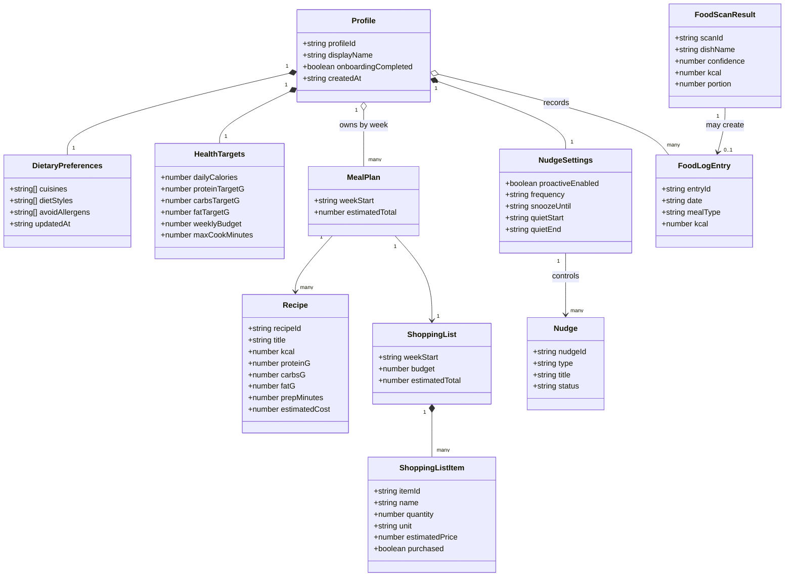

# NutriPal System Design

**Language: [中文](system-design.md) | English**

> - Status: design baseline v0.1 (2026-11-24)
> - Design baseline: [Figma eight-screen v2 archive](../../design/exports/2026-11-25-nutripal-v2/README.en.md)
> - Next document: [Module design](module-design.en.md)
> - Note: this document defines the logical architecture and contracts. It does not imply that a backend, database, or real AI service already exists.

## 1. Purpose and Scope

### 1.1 Goals

NutriPal supports dietary preferences, personalised recommendations, weekly meal planning, shopping-list generation, controllable proactive reminders, and food/nutrition estimation through photo or simulated input. The system design must ensure that:

- Every screen capability is traceable, with no UI module holding a third-party API directly.
- The front end can run a Mock version without a backend by using the same interface contract.
- Pages, modules, and tests do not need to redefine data boundaries when the backend is connected.
- Proactive suggestions are explainable, postponable, and dismissible, and respect quiet hours.
- Health, dietary, location, and image data follow data-minimisation principles.
- Unvalidated capabilities remain labelled as design assumptions rather than final requirements.

### 1.2 V1 scope

Included:

- F01 Dietary & Cultural Preferences
- F02 Personalised Meal Recommendations
- F03 Practical Meal Planning
- F03b Shopping List
- F04 Context-Aware Proactive Assistance
- F05 Notification Control & Explanation
- F06 AI Food Recognition & Calorie Estimation
- F07 Recipe Detail & Ingredient Swaps
- Mock data, repository interfaces, API contracts, and routes required by those screens

Excluded:

- Login, registration, social relationships, cloud sync, or multi-user collaboration.
- A real backend, database schema, deployment, or monitoring.
- Real AI food recognition, push delivery, background GPS tracking, or smart-watch integration.
- Medical diagnosis, treatment advice, or guarantees that a meal is allergen-free.
- Ingredient purchasing, delivery, payments, or real third-party merchant transactions.

### 1.3 Design status labels

| Label | Meaning |
| --- | --- |
| Baseline | Explicitly recorded in the current Figma design and this document; can be used directly for the prototype or implementation |
| Assumption | Derived from the team design or directional judgment; still requires user or technical validation |
| Reserved | Not implemented now, but an interface and boundary have been defined for later replacement |
| Gap | Figma does not provide a complete screen or flow; it must not be invented as a confirmed requirement |

## 2. System Principles

1. **Contract first:** UI depends on Repositories and API DTOs, not on a specific Mock or third-party field shape.
2. **Modular monolith:** Both front end and backend are organised by module; the backend can remain one deployable service rather than microservices.
3. **Isomorphic mocks:** Mock and the future real API share request, response, error, and timeout contracts.
4. **Single data owner:** Each data type has exactly one module responsible for writes; other modules consume it through Repositories or read-only selectors.
5. **User control:** Proactive suggestions must explain their reason and support postponement, frequency adjustment, and disabling.
6. **Data minimisation:** Raw images, precise trajectories, and unnecessary health information are not stored.
7. **Visible degradation:** When a third-party capability is unavailable, the interface explicitly shows the degraded result instead of fabricating “live” data.
8. **Framework-neutral:** The third meeting confirmed TypeScript + front-end components and reserved backend interfaces. The current scaffold uses React + Vite, but the system contract does not depend on that framework.

## 3. Architecture Design

### 3.1 Architecture style

- The client uses a mobile-first Web/PWA reference architecture based on a 390px design frame, with responsive expansion.
- The logical system is divided into presentation, application coordination, domain data access, and infrastructure-adapter layers.
- The backend is reserved as a modular monolith. Profile, Recommendations, Meal Planning, Nudges, and Food Scanning are logical modules, not required independent deployments.
- Recipes, weather, food recognition, and local notifications are accessed through Provider/Adapter interfaces so business modules do not bind to a vendor.
- V1 uses local Mock Adapters by default; real HTTP and Mock adapters must be interchangeable.

### 3.2 System context



### 3.3 Client containers and data access



Constraints:

- Pages and components must not call `fetch`, third-party SDKs, or `localStorage` directly.
- All external data is returned as domain objects by Repositories; API DTO validation and mapping happen inside the Repository.
- `NutriPalApi` and `MockNutriPalApi` expose the same method set, so switching implementations does not change page code.
- Local notification scheduling is consumer infrastructure. F04/F05 use `NotificationScheduler`; they do not request platform permissions directly.

### 3.4 Key data flow



Recommendations are not copied into the Preferences module. The meal plan and shopping list do not each maintain duplicate data. After preferences are saved, the application marks recommendations as stale and F02 requests recommendations again. After a meal plan changes, Meal Planning triggers a shopping-list recalculation.

## 4. Domain Model



### 4.1 Data ownership

| Data | Sole writer | Readers | Persistence strategy |
| --- | --- | --- | --- |
| Profile, preferences, health targets | Preferences | App Shell, Recommendations, Nudges | Eventually owned by Profile API; local Mock persistence in v1 |
| Daily recommendations and nutrition summary | Recommendations | Home | May be cached, but the server response is authoritative |
| Weekly meal plan | Meal Planning | Home, Shopping List | Unique key is `weekStart` |
| Shopping list | Shopping List | Meal Planning | Recalculated from the meal plan; purchased state is stored separately |
| Nudge settings / Nudge | Nudges | App Shell, notification entry | Settings persist; each nudge has status and expiry |
| FoodScanResult | Food Scan | Food Scan | Temporary; not retained long-term until the user confirms logging |
| FoodLogEntry | Food Scan / Daily Log | Home | Written to the current-day log after confirmation |
| UI state such as pages, forms, and selections | Owning module | Same module only | Not sent to the API; mutable objects are not shared across modules |

## 5. Capability and Screen Traceability

| Screen | Capability | Primary module | V1 data source | Status |
| --- | --- | --- | --- | --- |
| F01 | Save cuisine, dietary style, allergen/avoidance and custom avoidances | Preferences | MockProfileRepository | Baseline |
| F02 | Show daily nutrition summary, personalised recipes and a 91-recipe mock search | Recommendations | MockRecommendationRepository + mock recipes table | Baseline |
| F03 | Generate/view a weekly meal plan with budget and cooking constraints; swap meals | Meal Planning | MockMealPlanRepository | Baseline |
| F03b | Generate a shopping list with budget and check-off state from the meal plan | Shopping List | MockShoppingListRepository | Baseline |
| F04 | Show contextual proactive suggestions and their reasons | Nudges | Mock nudge fixture + NotificationScheduler | Mock |
| F05 | Enable/disable suggestions, snooze, frequency, quiet hours, and explain the latest nudge | Nudges | MockNudgeRepository | Baseline |
| F06 | Recognise or simulate food, adjust portion, and add to the daily log | Food Scan | MockFoodScanProvider | Mock |
| F07a–l | Show recipe details and demo lower/higher swaps, apply/undo and allergen filtering for Mapo Tofu | Recipe Detail | RecipeRepository + getRecipeDetail | Baseline, complete Mapo state flow |
| Me | Profile, preference/nudge entries, language, large text, nudge preview and privacy | Display / Profile | MockProfileRepository + DisplayPreferenceRepository | Independent v1.1 screen |

The following capabilities remain design gaps and do not create new pages:

- F02 `See all` expands more recommendations inline; it does not create an undesigned route.
- F06 `Edit dish`, the F05 feedback entry, `Order for delivery`, and real system notifications are outside v1. The UI must show an explicit demo-state explanation rather than silently failing.
- Real GPS/background triggering in F04 and real image recognition in F06 are preserved only as Provider interfaces.
- F07 swaps remain local to the recipe page and do not update the meal plan, shopping list or Home summary; other recipes do not receive fabricated swaps.

## 6. API Contract

### 6.1 Common rules

- Base path: `/api/v1`
- Content-Type: `application/json`
- Time: ISO 8601; dates use `YYYY-MM-DD`.
- IDs: opaque strings; clients must not parse their structure.
- Clients must not depend on array order; recommendation order follows the response order.
- Request timeout: 5 seconds for ordinary queries; 15 seconds for meal-plan generation or scanning.
- GET requests may be retried once safely. POST/PATCH are retried automatically only when an `Idempotency-Key` is supplied.
- Log creation and meal-plan generation/replacement must supply an `Idempotency-Key`; duplicate submissions with the same key return the first successful result.
- V1 local Mock uses an anonymous `profileId`. A future HTTP service derives the user from an authenticated session and never trusts a client-declared identity.

Success response:

```json
{
  "data": {},
  "meta": {
    "requestId": "req_mock_001",
    "generatedAt": "2026-11-24T18:00:00Z",
    "source": "mock"
  }
}
```

Error response:

```json
{
  "error": {
    "code": "PROVIDER_UNAVAILABLE",
    "message": "Recipe provider is temporarily unavailable.",
    "retryable": true,
    "details": {}
  }
}
```

Standard error codes: `VALIDATION_ERROR`, `NOT_FOUND`, `CONFLICT`, `PROVIDER_UNAVAILABLE`, `RATE_LIMITED`, `UNAUTHORIZED` (reserved), and `INTERNAL_ERROR`.

### 6.2 Endpoints

| Method | Path | Request | Success response | Owner |
| --- | --- | --- | --- | --- |
| GET | `/profile` | — | `Profile` | Preferences |
| PUT | `/profile/preferences` | `DietaryPreferencesInput` | `DietaryPreferences` | Preferences |
| GET | `/recommendations?date=YYYY-MM-DD&limit=3` | Query parameters | `RecommendationBundle` | Recommendations |
| GET | `/meal-plans/{weekStart}` | — | `MealPlan` or `NOT_FOUND` | Meal Planning |
| PUT | `/meal-plans/{weekStart}` | `MealPlanInput` | `MealPlan` | Meal Planning |
| PATCH | `/meal-plans/{weekStart}/meals/{mealId}` | `MealSwapInput` | `MealPlan` | Meal Planning |
| GET | `/shopping-lists/{weekStart}` | — | `ShoppingList` | Shopping List |
| PATCH | `/shopping-lists/{weekStart}/items/{itemId}` | `{ purchased: boolean }` | `ShoppingListItem` | Shopping List |
| GET | `/nudge-settings` | — | `NudgeSettings` | Nudges |
| PATCH | `/nudge-settings` | `NudgeSettingsPatch` | `NudgeSettings` | Nudges |
| GET | `/nudges/next` | Coarse `NudgeContext` query parameters | `Nudge` or `204 No Content` | Nudges |
| POST | `/food-scans` | `FoodScanInput` | `FoodScanResult` | Food Scan |
| POST | `/food-logs` | `FoodLogInput` | `FoodLogEntry` | Food Scan / Daily Log |

`GET /recommendations` defaults to `limit=3` and accepts 1–10; F02 `See all` uses 10.

`GET /nudges/next` accepts `date`, `localTime`, `coarseLocation`, `activityContext`, `lastMealAt`, `proteinShortfallG`, and repeated `expiringPantryItems` parameters. Only coarse location such as city/region is permitted; precise coordinates and continuous trajectories must not be sent.

### 6.3 DTOs

```ts
type ID = string;
type ISODate = string;
type MealType = "breakfast" | "lunch" | "dinner" | "snack";
type NudgeFrequency = "fewer" | "balanced" | "more";
type NudgeType = "meal_idea" | "hydration" | "snack_swap" | "contextual";

interface DietaryPreferencesInput {
  cuisines: string[];
  dietStyles: string[];
  avoidAllergens: string[];
}

interface MealPlanInput {
  budget: number;
  maxCookMinutes: number;
  pantryItems: string[];
}

interface MealSwapInput {
  excludeRecipeIds?: ID[];
}

interface NudgeContext {
  date: ISODate;
  localTime: string;
  coarseLocation?: string;
  activityContext?: "leaving_gym" | "home" | "work" | "other";
  lastMealAt?: string;
  proteinShortfallG?: number;
  expiringPantryItems?: string[];
}

type NudgeSettingsPatch = Partial<Omit<NudgeSettings, "updatedAt">>;

interface FoodScanInput {
  imageRef: string;
  portion?: number;
}

interface FoodLogInput {
  scanId: ID;
  portion: number;
}

interface Profile {
  profileId: ID;
  displayName: string;
  onboardingCompleted: boolean;
  createdAt: string;
  preferences: DietaryPreferences;
  healthTargets: HealthTargets;
}

interface DietaryPreferences {
  cuisines: string[];
  dietStyles: string[];
  avoidAllergens: string[];
  updatedAt: string;
}

interface HealthTargets {
  dailyCalories: number;
  proteinTargetG: number;
  carbsTargetG?: number;
  fatTargetG?: number;
  weeklyBudget: number;
  maxCookMinutes: number;
}

interface NutritionSummary {
  date: ISODate;
  consumedCalories: number;
  targetCalories: number;
  proteinG: number;
  carbsG: number;
  fatG: number;
}

interface Recipe {
  recipeId: ID;
  title: string;
  summary: string;
  imageRef?: string;
  tags: string[];
  prepMinutes: number;
  kcal: number;
  proteinG: number;
  carbsG: number;
  fatG: number;
  estimatedCost: number;
  whyRecommended: string;
}

interface RecommendationBundle {
  date: ISODate;
  nutrition: NutritionSummary;
  items: Recipe[];
}

interface MealSlot {
  mealId: ID;
  date: ISODate;
  type: MealType;
  recipeId: ID;
  recipeName: string;
  servings: number;
  kcal: number;
  prepMinutes: number;
  estimatedCost: number;
}

interface MealPlan {
  weekStart: ISODate;
  budget: number;
  maxCookMinutes: number;
  pantryItems: string[];
  meals: MealSlot[];
  estimatedTotal: number;
  updatedAt: string;
}

interface ShoppingListItem {
  itemId: ID;
  name: string;
  quantity: number;
  unit: string;
  estimatedPrice: number;
  purchased: boolean;
  sourceMealIds: ID[];
}

interface ShoppingList {
  weekStart: ISODate;
  budget: number;
  estimatedTotal: number;
  pantryItems: string[];
  items: ShoppingListItem[];
}

interface NudgeSettings {
  proactiveEnabled: boolean;
  frequency: NudgeFrequency;
  snoozeUntil: string | null;
  quietHours: { start: string; end: string };
  categories: Record<NudgeType, boolean>;
  updatedAt: string;
}

interface Nudge {
  nudgeId: ID;
  type: NudgeType;
  title: string;
  body: string;
  reasonFactors: string[];
  primaryAction: { label: string; target: string };
  secondaryActions: string[];
  createdAt: string;
  expiresAt: string;
  status: "available" | "dismissed" | "accepted" | "expired";
}

interface FoodScanResult {
  scanId: ID;
  dishName: string;
  confidence: number;
  portion: number;
  kcal: number;
  proteinG: number;
  carbsG: number;
  fatG: number;
  ingredients: string[];
  needsReview: boolean;
}

interface FoodLogEntry {
  entryId: ID;
  date: ISODate;
  mealType: MealType;
  dishName: string;
  portion: number;
  kcal: number;
  proteinG: number;
  carbsG: number;
  fatG: number;
  sourceScanId?: ID;
  createdAt: string;
}
```

## 7. External Capabilities and Mock Strategy

| Abstract interface | V1 implementation | Reserved real implementation | Key constraint |
| --- | --- | --- | --- |
| `RecipeProvider` | Fixed recipe fixture | TheMealDB-like service | Vendor fields must not leak into UI; allergen relationships need separate data |
| `WeatherProvider` | Fixed city/weather fixture | Open-Meteo-like service | Send coarse location only; failure must not block the meal-plan core flow |
| `FoodRecognitionProvider` | 1–3 food fixtures | Image-recognition service | Raw images are not persisted by default; users must be able to correct results |
| `NotificationScheduler` | In-page preview and simulated notifications | Web Push/system notifications | Demo must work without requesting permission; permission failure must be explained |
| `ProfileStore` | Local fixture | Backend database | Importing/clearing preferences must be explicit |

Mock rules:

- The same `date`, `weekStart`, and preference inputs return deterministic results for screenshots and tests.
- Mocks provide `success`, `empty`, `timeout`, and `provider-unavailable` modes; `success` is the default.
- Mock-generated data must be labelled as simulated in the UI and must never present fabricated live measurements.

### 7.1 Regression screenshot fixtures

The specific values visible in Figma are used for visual regression and demonstrations, not as real health data:

| Screen | Fixed fixture |
| --- | --- |
| F01 | Chinese + Italian, Vegetarian, no allergens selected; production first use has no preselection |
| F02 | 1,240 / 1,900 kcal; Protein 62g, Carbs 140g, Fat 38g; Mapo Tofu as the first recommendation |
| F03 | Week of 2026-11-23; £35 budget, ≤30 minutes, six pantry items; Tuesday meals are Omelette / Chicken Rice Bowl / Tomato Egg Stir-fry |
| F03b | £12.40 / £35; four items to buy and six pantry items |
| F04 | 2026-11-24 18:42; leaving the gym, four hours since a meal, Protein 62/110g, rice expires tomorrow |
| F05 | Proactive suggestions on; Balanced; quiet hours 22:00–07:30; Hydration reminders off |
| F06 | Beef Noodle Soup; 92% confidence; one portion at 610 kcal / 34g protein / 72g carbs / 18g fat |

`FoodScanResult.portion` means number of portions (1–5), not grams. The UI may also show the approximate gram value from the design, but calculations use portion count.

When no local Profile exists, Mock creates an anonymous profile: `displayName="Alex"` is a screenshot fixture only; `onboardingCompleted=false`; preference arrays are empty. Health targets default to 1,900 kcal, Protein 110g, £35/week, and ≤30 minutes; carbohydrate and fat targets are unset. Nudges default to enabled, Balanced, quiet hours 22:00–07:30, with categories enabled except Hydration reminders.

## 8. Navigation and State Rules

| Scenario | Behaviour |
| --- | --- |
| First launch | If `onboardingCompleted=false`, open `/preferences` |
| Onboarding complete | Open `/home` |
| Save preferences (first time) | Set `onboardingCompleted=true`, open `/home`, and refresh recommendations |
| Edit preferences from Me | Reuse `/preferences?mode=edit`; save returns to the source screen, cancel preserves the previous values |
| F02 See all | Expand more recommendations inline; do not create a route |
| F02 recipe card / search result | Open `/recipe/:recipeId`; invalid IDs return to `/home` |
| F07 apply/undo swap | Update only the current recipe page state; reset after leaving |
| F03 generate/replace meal plan | Write MealPlan; on success refresh ShoppingList; on failure preserve the previous plan |
| F03b check an item | Write only `purchased`; do not change budget calculation |
| F04 accept/postpone/dismiss | Update Nudge status; `Start cooking` navigates to `/plan` and focuses the corresponding meal |
| F05 change settings | Save each field and show success; on failure restore the previous value |
| F06 add to daily log | Write FoodLogEntry, return to `/home`, and refresh the nutrition summary |
| Protected screen without onboarding | Redirect to `/preferences` |
| Unknown route | Open `/home` (or `/preferences` if onboarding is incomplete) |

## 9. Privacy, Security, and Accessibility

- Allergen filtering can only reduce risk. The UI must show a protective notice asking users to verify ingredients and must not promise absolute safety.
- Location is limited to a coarse region permitted by the user; trajectories are not recorded.
- Scan results are temporary by default. A FoodLogEntry is created only after user confirmation.
- Raw images are not written to logs, `localStorage`, or error reports.
- All user-facing text, buttons, and forms must be keyboard accessible and have readable labels.
- Touch targets must be at least 44×44px; status must not be communicated by colour alone.
- Support reduced motion; loading states must not block page reading.
- Do not provide medical diagnosis, treatment, or medical nutrition advice.

## 10. Non-functional Requirements

| Area | Target |
| --- | --- |
| First interactive state | Within 2 seconds under local Mock |
| Orientation | 390px design baseline with a fluid content column, compatible with 320–1200px |
| Error recovery | Every data module has loading, empty, error, and retry states |
| Data consistency | Preferences, meal plan, and shopping list update through a single domain object, avoiding duplicate copies |
| Traceability | Every user flow can be traced to a Figma frame, module interface, and test scenario |
| Replaceability | Swapping Mock/real Adapters does not affect UI modules |

## 11. Acceptance

- All eight Figma screens (16 default/large-text frames) map to modules, and no UI module bypasses the data-access layer for third-party APIs.
- All DTOs use the same names and field semantics in API endpoints, Repositories, and module design.
- Proactive suggestions have settings, explanation, postponement, and dismissal paths; scan results can be corrected and are not medical evidence.
- The offline Mock can demonstrate the F01→F02→F03→F03b main journey and simulated F04/F05/F06 flows end to end.
- Design gaps in this document are not silently implemented as requirements.
