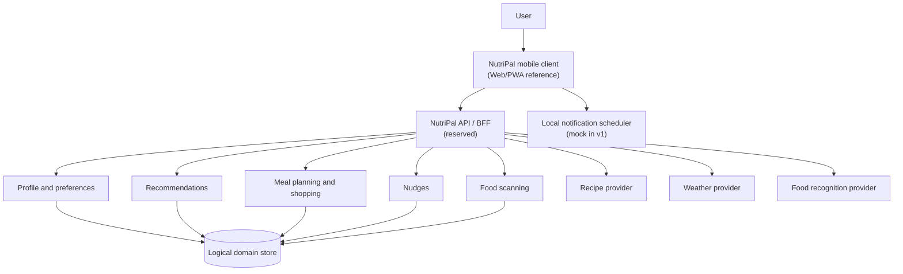
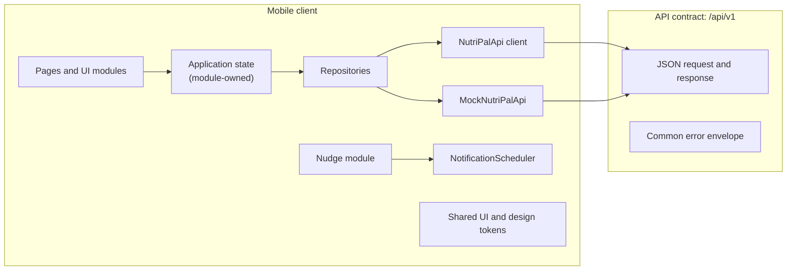
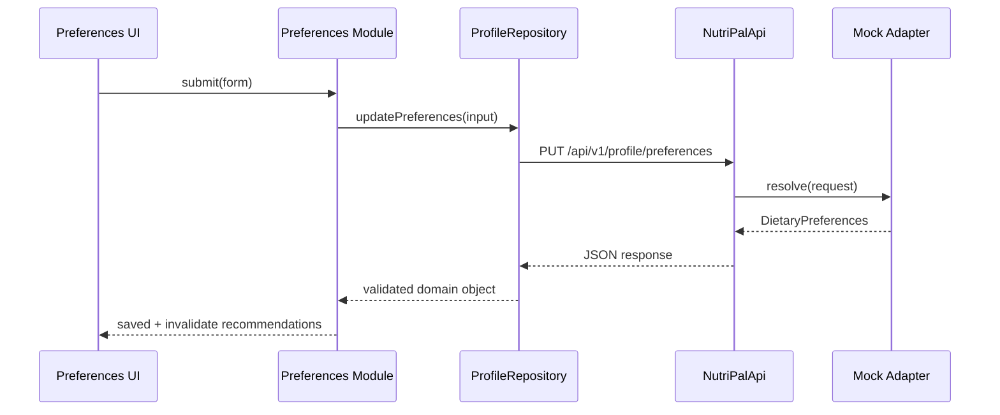
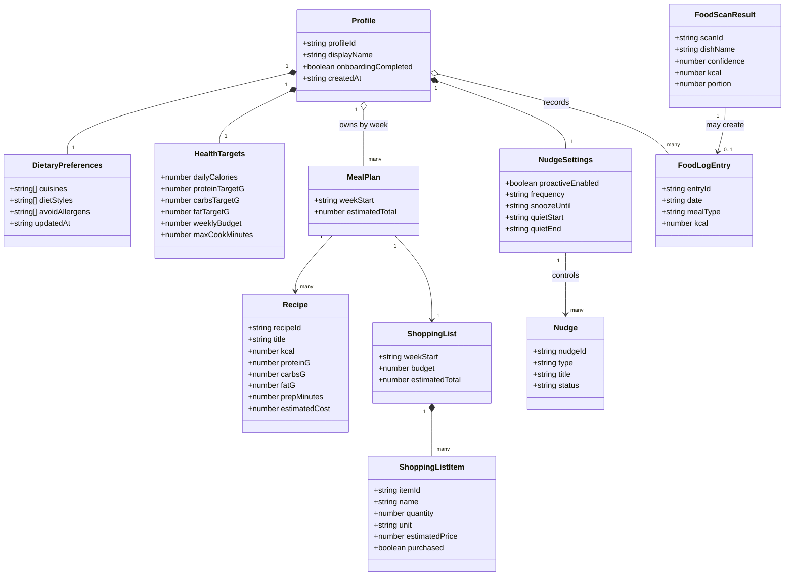

# NutriPal 系统设计

**语言：[中文](system-design.md) | [English](system-design.en.md)**

> - 状态：设计基线 v0.1（2026-11-24）
> - 设计基线：[Figma 8 屏 v2 归档](../../design/exports/2026-11-25-nutripal-v2/README.md)
> - 后续文档：[模块设计](module-design.md)
> - 说明：本文定义逻辑架构与契约，不代表已经存在后端、数据库或真实 AI 服务。

## 1. 目的与范围

### 1.1 目标

NutriPal 支持用户管理饮食偏好、查看个性化推荐、规划每周餐单、生成购物清单、接收可控的主动提醒，并通过拍照或模拟输入估算食物营养。系统设计需要保证：

- 页面与数据能力一一可追溯，不出现 UI 直接持有第三方 API 的情况。
- 前端可以在没有后端的情况下，通过同一接口契约运行 Mock 版本。
- 后端接入后，页面、模块和测试不需要重新定义数据边界。
- 主动建议可解释、可推迟、可关闭，并遵守免打扰时间。
- 健康、饮食、位置和图像数据遵循最小化原则。
- 当前未经验证的功能保持“设计假设”状态，不冒充最终需求。

### 1.2 首版边界

包含：

- F01 Dietary & Cultural Preferences
- F02 Personalised Meal Recommendations
- F03 Practical Meal Planning
- F03b Shopping List
- F04 Context-Aware Proactive Assistance
- F05 Notification Control & Explanation
- F06 AI Food Recognition & Calorie Estimation
- 完成上述页面所需的 Mock 数据、仓储接口、API 契约和路由。

不包含：

- 登录、注册、社交关系、云同步和多用户协作。
- 真实后端、数据库 schema、部署和监控。
- 真实 AI 食物识别、推送服务、GPS 后台追踪或智能手表接入。
- 医疗诊断、治疗建议和“保证无过敏原”的承诺。
- 购买食材、配送、支付及与第三方商家的真实交易。

### 1.3 设计状态

| 标签 | 含义 |
| --- | --- |
| 基线 | 当前 Figma 和本文明确记录的设计，可以直接用于原型或实现 |
| 假设 | 来自团队设计稿或方向性判断，仍需用户研究或技术验证 |
| 预留 | 当前不实现，但接口和边界已经定义，后续可替换 |
| 缺口 | Figma 未提供完整页面或流程，当前不得自行扩展为确定需求 |

## 2. 系统原则

1. **契约先行**：UI 依赖 Repository 和 API DTO，不依赖具体 Mock 或第三方服务字段。
2. **模块化单体**：初期前端与后端都按模块组织；后端可作为一个可部署服务，不拆微服务。
3. **Mock 同构**：Mock 与未来真实 API 共用同一请求、响应、错误和超时契约。
4. **单一数据所有者**：每类数据只有一个模块负责写入，其他模块通过 Repository 或只读选择器使用。
5. **用户控制**：主动建议必须能解释原因，并支持推迟、频率调整和关闭。
6. **隐私最小化**：不保存原始图像、精确轨迹或不必要的健康信息。
7. **降级可见**：第三方能力不可用时，界面明确显示降级结果，而不是伪造“实时”数据。
8. **框架中立**：第三次会议已确认 TypeScript + 前端组件和预留后端接口；当前脚手架选用 React + Vite，但系统契约不依赖该框架。

## 3. 架构设计

### 3.1 架构风格

- 客户端采用移动端优先的 Web/PWA 参考架构，页面宽度以 390px 设计稿为基础，并允许响应式扩展。
- 系统逻辑分为展示层、应用协调层、领域数据访问层和基础设施适配层。
- 后端预留为模块化单体：Profile、Recommendations、Meal Planning、Nudges 和 Food Scanning 是逻辑模块，不要求独立部署。
- 食谱、天气、食物识别与本地通知通过 Provider/Adapter 接口访问，避免业务模块直接绑定供应商。
- 首版默认使用本地 Mock Adapter；真实 HTTP Adapter 与 Mock Adapter 必须可互换。

### 3.2 系统上下文



### 3.3 客户端容器与数据访问



约束：

- 页面和组件不得直接调用 `fetch`、第三方 SDK 或 `localStorage`。
- 所有外部数据由 Repository 返回领域对象；API DTO 在 Repository 内完成校验和映射。
- `NutriPalApi` 与 `MockNutriPalApi` 暴露同一方法集；切换实现不改变页面代码。
- 本地通知调度属于消费者基础设施，F04/F05 通过 `NotificationScheduler` 使用，不直接申请平台权限。

### 3.4 关键数据流



推荐数据不复制进偏好模块，餐单与购物清单也不各自维护相同字段。偏好保存后，由应用层标记推荐失效，F02 重新请求推荐；餐单更新后，由 Meal Planning 模块重新计算购物清单。

## 4. 领域模型



### 4.1 数据所有权

| 数据 | 唯一写入模块 | 读取方 | 持久化策略 |
| --- | --- | --- | --- |
| Profile、偏好、健康目标 | Preferences | App Shell、Recommendations、Nudges | 后期由 Profile API 持有；v1 由本地 Mock 持久化 |
| 每日推荐与营养摘要 | Recommendations | Home | 可缓存但以服务端返回为准 |
| 每周餐单 | Meal Planning | Home、Shopping List | 以 `weekStart` 为唯一键 |
| 购物清单 | Shopping List | Meal Planning | 由餐单重算；勾选状态单独保存 |
| Nudge settings / Nudge | Nudges | App Shell、通知入口 | 设置持久化；单条提醒有状态和过期时间 |
| FoodScanResult | Food Scan | Food Scan | 临时结果；用户确认加入日志前不长期保存 |
| FoodLogEntry | Food Scan / Daily Log | Home | 加入日志后写入当天记录 |
| 页面、表单、选中项等 UI 状态 | 所在模块 | 仅本模块 | 不进入 API，不跨模块共享可变对象 |

## 5. 功能能力与页面追溯

| 页面 | 业务能力 | 主要模块 | 首版数据来源 | 状态 |
| --- | --- | --- | --- | --- |
| F01 | 保存菜系、饮食风格、过敏/忌口和自定义忌口 | Preferences | MockProfileRepository | 基线 |
| F02 | 展示每日营养摘要、个性化食谱和 91 道菜谱 Mock 搜索 | Recommendations | MockRecommendationRepository + mock recipes table | 基线 |
| F03 | 生成/查看周餐单、预算与烹饪限制、替换餐食 | Meal Planning | MockMealPlanRepository | 基线 |
| F03b | 从餐单生成购物清单、预算与勾选 | Shopping List | MockShoppingListRepository | 基线 |
| F04 | 展示情境化主动建议及原因 | Nudges | Mock Nudge fixture + NotificationScheduler | 模拟 |
| F05 | 开关建议、延后、频率、免打扰、解释最近提醒 | Nudges | MockNudgeRepository | 基线 |
| F06 | 识别/模拟识别食物、调整份量、加入当天记录 | Food Scan | MockFoodScanProvider | 模拟 |
| Me | 个人资料、偏好/通知入口、语言、大字号、预览提醒和隐私说明 | Display / Profile | MockProfileRepository + DisplayPreferenceRepository | v1.1 独立页面 |

以下能力仍是设计缺口，不新增页面：

- F02 的 `See all` 仅在同一页面内展开更多推荐，不创建未设计的新路由。
- F06 的 `Edit dish`、F05 的反馈入口、`Order for delivery` 和真实系统推送不在首版功能范围；UI 应显示明确的演示态说明，不能静默失败。
- F04 的真实 GPS/后台触发、F06 的真实图像识别仅保留 Provider 接口。

## 6. API 契约

### 6.1 通用规则

- Base path：`/api/v1`
- Content-Type：`application/json`
- 时间：ISO 8601；日期使用 `YYYY-MM-DD`。
- ID：不透明字符串，客户端不得解析其结构。
- 客户端不得依赖数组顺序；推荐顺序以接口返回顺序为准。
- 请求超时：普通查询 5 秒；生成餐单或扫描允许 15 秒。
- GET 请求可安全重试一次；POST/PATCH 只有带 `Idempotency-Key` 时才自动重试。
- 创建日志和生成/替换餐单必须提供 `Idempotency-Key`；同一键重复提交返回第一次成功结果。
- v1 本地 Mock 使用匿名 `profileId`；未来 HTTP 服务由鉴权会话确定用户，不接受客户端自行声明身份。

成功响应：

```json
{
  "data": {},
  "meta": {
    "requestId": "req_mock_001",
    "generatedAt": "2026-11-24T18:00:00Z",
    "source": "mock"
  }
}
```

错误响应：

```json
{
  "error": {
    "code": "PROVIDER_UNAVAILABLE",
    "message": "Recipe provider is temporarily unavailable.",
    "retryable": true,
    "details": {}
  }
}
```

标准错误码：`VALIDATION_ERROR`、`NOT_FOUND`、`CONFLICT`、`PROVIDER_UNAVAILABLE`、`RATE_LIMITED`、`UNAUTHORIZED`（预留）、`INTERNAL_ERROR`。

### 6.2 端点

| 方法 | 路径 | 请求 | 成功响应 | 所有者 |
| --- | --- | --- | --- | --- |
| GET | `/profile` | — | `Profile` | Preferences |
| PUT | `/profile/preferences` | `DietaryPreferencesInput` | `DietaryPreferences` | Preferences |
| GET | `/recommendations?date=YYYY-MM-DD&limit=3` | 查询参数 | `RecommendationBundle` | Recommendations |
| GET | `/meal-plans/{weekStart}` | — | `MealPlan` 或 `NOT_FOUND` | Meal Planning |
| PUT | `/meal-plans/{weekStart}` | `MealPlanInput` | `MealPlan` | Meal Planning |
| PATCH | `/meal-plans/{weekStart}/meals/{mealId}` | `MealSwapInput` | `MealPlan` | Meal Planning |
| GET | `/shopping-lists/{weekStart}` | — | `ShoppingList` | Shopping List |
| PATCH | `/shopping-lists/{weekStart}/items/{itemId}` | `{ purchased: boolean }` | `ShoppingListItem` | Shopping List |
| GET | `/nudge-settings` | — | `NudgeSettings` | Nudges |
| PATCH | `/nudge-settings` | `NudgeSettingsPatch` | `NudgeSettings` | Nudges |
| GET | `/nudges/next` | 粗粒度 `NudgeContext` 查询参数 | `Nudge` 或 `204 No Content` | Nudges |
| POST | `/food-scans` | `FoodScanInput` | `FoodScanResult` | Food Scan |
| POST | `/food-logs` | `FoodLogInput` | `FoodLogEntry` | Food Scan / Daily Log |

`GET /recommendations` 的 `limit` 默认 3，允许 1–10；F02 的 `See all` 使用 10。

`GET /nudges/next` 接受 `date`、`localTime`、`coarseLocation`、`activityContext`、`lastMealAt`、`proteinShortfallG` 和重复的 `expiringPantryItems` 参数。只允许城市/地区等粗略位置，不得发送精确坐标或连续轨迹。

### 6.3 DTO 字段

```ts
type ID = string;
type ISODate = string;
type MealType = "breakfast" | "lunch" | "dinner" | "snack";
type NudgeFrequency = "fewer" | "balanced" | "more";
type NudgeType = "meal_idea" | "hydration" | "snack_swap" | "contextual";

interface DietaryPreferencesInput {
  cuisines: string[];
  dietStyles: string[];
  avoidAllergens: string[];
}

interface MealPlanInput {
  budget: number;
  maxCookMinutes: number;
  pantryItems: string[];
}

interface MealSwapInput {
  excludeRecipeIds?: ID[];
}

interface NudgeContext {
  date: ISODate;
  localTime: string;
  coarseLocation?: string;
  activityContext?: "leaving_gym" | "home" | "work" | "other";
  lastMealAt?: string;
  proteinShortfallG?: number;
  expiringPantryItems?: string[];
}

type NudgeSettingsPatch = Partial<Omit<NudgeSettings, "updatedAt">>;

interface FoodScanInput {
  imageRef: string;
  portion?: number;
}

interface FoodLogInput {
  scanId: ID;
  portion: number;
}

interface Profile {
  profileId: ID;
  displayName: string;
  onboardingCompleted: boolean;
  createdAt: string;
  preferences: DietaryPreferences;
  healthTargets: HealthTargets;
}

interface DietaryPreferences {
  cuisines: string[];
  dietStyles: string[];
  avoidAllergens: string[];
  updatedAt: string;
}

interface HealthTargets {
  dailyCalories: number;
  proteinTargetG: number;
  carbsTargetG?: number;
  fatTargetG?: number;
  weeklyBudget: number;
  maxCookMinutes: number;
}

interface NutritionSummary {
  date: ISODate;
  consumedCalories: number;
  targetCalories: number;
  proteinG: number;
  carbsG: number;
  fatG: number;
}

interface Recipe {
  recipeId: ID;
  title: string;
  summary: string;
  imageRef?: string;
  tags: string[];
  prepMinutes: number;
  kcal: number;
  proteinG: number;
  carbsG: number;
  fatG: number;
  estimatedCost: number;
  whyRecommended: string;
}

interface RecommendationBundle {
  date: ISODate;
  nutrition: NutritionSummary;
  items: Recipe[];
}

interface MealSlot {
  mealId: ID;
  date: ISODate;
  type: MealType;
  recipeId: ID;
  recipeName: string;
  servings: number;
  kcal: number;
  prepMinutes: number;
  estimatedCost: number;
}

interface MealPlan {
  weekStart: ISODate;
  budget: number;
  maxCookMinutes: number;
  pantryItems: string[];
  meals: MealSlot[];
  estimatedTotal: number;
  updatedAt: string;
}

interface ShoppingListItem {
  itemId: ID;
  name: string;
  quantity: number;
  unit: string;
  estimatedPrice: number;
  purchased: boolean;
  sourceMealIds: ID[];
}

interface ShoppingList {
  weekStart: ISODate;
  budget: number;
  estimatedTotal: number;
  pantryItems: string[];
  items: ShoppingListItem[];
}

interface NudgeSettings {
  proactiveEnabled: boolean;
  frequency: NudgeFrequency;
  snoozeUntil: string | null;
  quietHours: { start: string; end: string };
  categories: Record<NudgeType, boolean>;
  updatedAt: string;
}

interface Nudge {
  nudgeId: ID;
  type: NudgeType;
  title: string;
  body: string;
  reasonFactors: string[];
  primaryAction: { label: string; target: string };
  secondaryActions: string[];
  createdAt: string;
  expiresAt: string;
  status: "available" | "dismissed" | "accepted" | "expired";
}

interface FoodScanResult {
  scanId: ID;
  dishName: string;
  confidence: number;
  portion: number;
  kcal: number;
  proteinG: number;
  carbsG: number;
  fatG: number;
  ingredients: string[];
  needsReview: boolean;
}

interface FoodLogEntry {
  entryId: ID;
  date: ISODate;
  mealType: MealType;
  dishName: string;
  portion: number;
  kcal: number;
  proteinG: number;
  carbsG: number;
  fatG: number;
  sourceScanId?: ID;
  createdAt: string;
}
```

## 7. 外部能力与 Mock 策略

| 抽象接口 | 首版实现 | 真实实现预留 | 关键约束 |
| --- | --- | --- | --- |
| `RecipeProvider` | 固定食谱 fixture | TheMealDB 类服务 | 供应商字段不得泄漏到 UI；过敏关系必须有独立数据 |
| `WeatherProvider` | 固定城市/天气 fixture | Open-Meteo 类服务 | 只传粗略位置；失败时不影响餐单核心流程 |
| `FoodRecognitionProvider` | 1–3 个食物 fixture | 图片识别服务 | 默认不持久化原始图片；结果必须允许修正 |
| `NotificationScheduler` | 页面内预览和模拟通知 | Web Push/系统通知 | 不申请权限也能演示；权限失败可解释 |
| `ProfileStore` | 本地 fixture | 后端数据库 | 导入/清除偏好必须显式 |

Mock 规则：

- 相同 `date`、`weekStart` 与偏好输入返回确定性结果，便于截图和测试。
- Mock 提供 `success`、`empty`、`timeout`、`provider-unavailable` 四种模式，默认 `success`。
- Mock 生成的数据必须在 UI 中标记为模拟来源，不得显示伪造的实时测量值。

### 7.1 回归截图 fixture

Figma 中出现的具体数值用于视觉回归和演示，不作为真实健康数据：

| 页面 | 固定 fixture |
| --- | --- |
| F01 | Chinese + Italian、Vegetarian、无过敏选择；生产首用不预选 |
| F02 | 1,240 / 1,900 kcal；Protein 62g、Carbs 140g、Fat 38g；Mapo Tofu 为首个推荐 |
| F03 | 2026-11-23 周；£35 预算、≤30 分钟、6 项现有食材；周二三餐为 Omelette / Chicken Rice Bowl / Tomato Egg Stir-fry |
| F03b | £12.40 / £35；4 项待购，已有食材 6 项 |
| F04 | 2026-11-24 18:42；离开健身房、4 小时未进食、Protein 62/110g、米饭明日到期 |
| F05 | 主动建议开启、Balanced、Quiet hours 22:00–07:30；Hydration reminders 关闭 |
| F06 | Beef Noodle Soup；92% confidence；1 份 610 kcal / 34g protein / 72g carbs / 18g fat |

`FoodScanResult.portion` 表示份数（1–5），不是克数；界面可同时展示设计稿中的约数克重，但计算以份数为准。

无本地 Profile 时，Mock 创建匿名 profile：`displayName="Alex"` 仅作截图 fixture，`onboardingCompleted=false`，偏好数组为空；健康目标默认 1,900 kcal、Protein 110g、£35/周、≤30 分钟，碳水/脂肪目标未设置。Nudge 默认开启、Balanced、22:00–07:30 免打扰，除 Hydration reminders 外类别开启。

## 8. 导航与状态规则

| 场景 | 行为 |
| --- | --- |
| 首次启动 | 若 `onboardingCompleted=false`，进入 `/preferences` |
| 已完成引导 | 打开 `/home` |
| 保存偏好（首次） | 设置 `onboardingCompleted=true`，进入 `/home` 并刷新推荐 |
| 从 Me 编辑偏好 | 复用 `/preferences?mode=edit`；保存后返回来源页，取消则保留原值 |
| F02 See all | 在 F02 内展开更多推荐，不新增路由 |
| F03 生成/替换餐单 | 写入 MealPlan；成功后刷新 ShoppingList，失败保留旧计划 |
| F03b 勾选采购 | 只写入 `purchased`，不改变预算计算 |
| F04 接受/推迟/关闭 | 更新 Nudge 状态；`Start cooking` 跳到 `/plan` 并定位对应餐次 |
| F05 修改设置 | 逐项保存并显示成功状态；失败恢复旧值 |
| F06 加入当天记录 | 写入 FoodLogEntry，返回 `/home` 并刷新营养摘要 |
| 未完成引导访问受保护页面 | 重定向 `/preferences` |
| 未知路由 | 进入 `/home`（未完成引导则进入 `/preferences`） |

## 9. 隐私、安全与可及性

- 过敏筛选只能减少风险，界面需显示“请核对食材”的保护性提示，不能承诺绝对安全。
- 位置只使用用户允许的粗略区域；不记录轨迹。
- 扫描结果默认临时保存；用户确认后才创建 FoodLogEntry。
- 不将原始图像写入日志、localStorage 或错误上报。
- 所有用户可见文字、按钮和表单均需可键盘访问，并有可读标签。
- 触控目标最小 44×44 px；状态不能只用颜色表达。
- 支持减少动效；加载态不得阻塞页面读取。
- 不提供医疗诊断、治疗或营养素医学建议。

## 10. 非功能要求

| 项目 | 目标 |
| --- | --- |
| 首屏可交互 | 本地 Mock 下 2 秒内 |
| 页面方向 | 390px 宽度为设计基准，内容列流体扩展并兼容 320–1200px |
| 错误恢复 | 每个数据模块都有 loading、empty、error、retry |
| 数据一致性 | 偏好、餐单和购物清单通过单一领域对象更新，避免多份副本 |
| 可追溯性 | 每个用户流程可追踪到 Figma frame、模块接口和测试场景 |
| 可替换性 | 替换 Mock/真实 Adapter 不影响 UI 模块 |

## 11. 验收

- 8 个 Figma 页面（16 个默认/大字号 Frame）全部在追溯矩阵中对应到模块，且无 UI 模块越层访问第三方接口。
- 所有 DTO 在 API 端点、Repository 和模块设计中同名、同字段语义。
- 主动建议有设置、解释、推迟和关闭路径；扫描结果可修正且不作为医疗依据。
- Mock 离线场景能完整演示 F01→F02→F03→F03b 主链路，以及 F04/F05/F06 的模拟流程。
- 文档中的设计缺口不会被实现为隐性默认需求。
